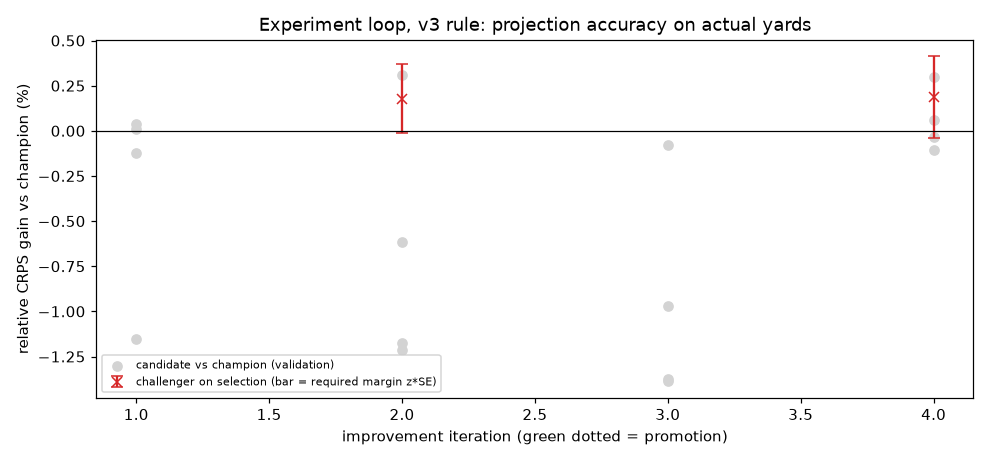
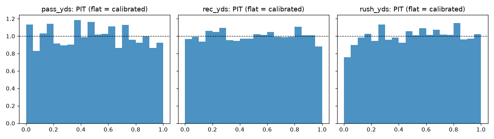

# NFL player-prop research pipeline — summary report (v3, after Tester1's second review)

> **Read this first.** No real historical prop odds exist here for 2015-2024, and the line simulator turned out to be
> learnable (Tester1 N1), so **no betting result from simulated lines is reported or used for any decision**. Models
> are now promoted on projection accuracy against actual yards. The only real-price test is the frozen 2025 holdout
> against **ESPN BET lines of uncertain timing** (a null result). The 2026 test runs on free DraftKings-via-ESPN line
> snapshots, which have **no prices**.

## Versions
* code version `6ddb05f9`; features `v2-asof`; feature/prediction caches are keyed on code + config
  + a content hash of the data actually used (data version `f78fc34e` for 2015-2025).
* Periods: validation [2019, 2020, 2021, 2022], selection [2023, 2024], frozen holdout 2025.

## Leakage check — current: PASS; legacy v1: FAIL (as it should)
```
== current features ==
[PASS] cutoff 2019-11-10: 29,840 rows checked (269 on the cutoff day itself), 0 feature values changed; post-cutoff feature values changed by scramble: 2,969,371
[PASS] cutoff 2022-09-11: 47,150 rows checked (349 on the cutoff day itself), 0 feature values changed; post-cutoff feature values changed by scramble: 1,830,653
[PASS] cutoff 2024-12-22: 67,057 rows checked (295 on the cutoff day itself), 0 feature values changed; post-cutoff feature values changed by scramble: 515,396
[PASS] max |corr(feature, passing_yards)| = 0.919 (naive_pass_yds)
[PASS] max |corr(feature, rushing_yards)| = 0.763 (mkt_proj_rush_yds)
[PASS] max |corr(feature, receiving_yards)| = 0.661 (p_receiving_yards_ewm6)
OVERALL: PASS
```
<details><summary>legacy v1 output</summary>

```
== LEGACY v1 features (expected to FAIL) ==
[FAIL] cutoff 2019-11-10: 29,840 rows checked (269 on the cutoff day itself), 1860 feature values changed; post-cutoff feature values changed by scramble: 2,886,649
   offending columns: {'implied_tt': 269, 'wind': 269, 'temp': 269, 'total_line': 269, 'team_spread': 269, 'mkt_proj_rec_yds': 233, 'mkt_proj_rush_yds': 171, 'dome': 49, 'mkt_proj_pass_yds': 40, 'is_starting_qb': 22}
[FAIL] cutoff 2022-09-11: 47,150 rows checked (349 on the cutoff day itself), 2427 feature values changed; post-cutoff feature values changed by scramble: 1,779,351
   offending columns: {'implied_tt': 349, 'wind': 349, 'temp': 349, 'total_line': 349, 'team_spread': 349, 'mkt_proj_rec_yds': 284, 'mkt_proj_rush_yds': 214, 'dome': 101, 'mkt_proj_pass_yds': 55, 'is_starting_qb': 28}
[FAIL] cutoff 2024-12-22: 67,057 rows checked (295 on the cutoff day itself), 2091 feature values changed; post-cutoff feature values changed by scramble: 500,706
   offending columns: {'implied_tt': 295, 'wind': 295, 'temp': 295, 'total_line': 295, 'team_spread': 295, 'mkt_proj_rec_yds': 271, 'mkt_proj_rush_yds': 201, 'dome': 76, 'mkt_proj_pass_yds': 47, 'is_starting_qb': 21}
[PASS] max |corr(feature, passing_yards)| = 0.926 (is_starting_qb)
[PASS] max |corr(feature, rushing_yards)| = 0.763 (mkt_proj_rush_yds)
[PASS] max |corr(feature, receiving_yards)| = 0.661 (p_receiving_yards_ewm6)
OVERALL: FAIL
```
</details>

## Pre-game scoring (Tester1 N2)
`python -m nflprops.pregame --season S --week W` builds rows for scheduled, unplayed games from data before the
week's first game day only. **Universe = every line in the decision snapshot D** (last capture ≥ 3 h before
kickoff), never the players who later appear in stats/snaps. A D line with no matching player row (no GSIS match,
event not in schedule, no prior NFL data, player's last team not in the game) is written to a per-run void report.
Without a D file the command runs as a clearly labelled DRY RUN (recent-appearance candidates), which never feeds
tracking. As-of equivalence on a played week (pre-game rows vs the post-game build of the same player-games):
* `{"n_pregame_rows": 416, "n_played_rows": 356, "n_matched": 330, "played_rows_not_candidates": 26, "candidates_who_did_not_play": 86, "n_features": 78, "features_with_differences": {}, "season": 2025, "week": 10, "pred_file": "data/predictions/2025_wk10/pregame_20261004T215313Z.parquet", "mode": "DRY RUN (no D snapshot: recent-appearance candidates)", "checked_at": "2026-10-04T14:53:16-07:00"}`
* `{"n_pregame_rows": 32, "n_played_rows": 378, "n_matched": 15, "played_rows_not_candidates": 363, "candidates_who_did_not_play": 17, "n_features": 78, "features_with_differences": {}, "season": 2026, "week": 4, "pred_file": "data/predictions/2026_wk04/pregame_20261005T173631Z.parquet", "mode": "snapshot (D lines)", "checked_at": "2026-10-05T10:36:37-07:00", "pred_sha256": "872a4e2aaf1de09b92d212d0ca0daa42db89887f635048e1cbeff28b71451135", "d_lines_sha256": "0e098f9d1e015aef99221b099edb6c83773b287fe882895e7acfddac12d0396c"}`

## Improvement loop, v3 rule (projection accuracy; no lines)
Candidates are walk-forwarded on validation with **no lines** and scored by CRPS of the predictive distribution
against actual yards. The score is the per-market relative CRPS gain over the champion, averaged over player-games.
A challenger must gain overall **and in at least 3 of the 4 validation seasons** (3/4, not 4/4).
On selection [2023, 2024] it must then clear z × SE (paired game-clustered bootstrap), with z = Φ⁻¹(1 − 0.05/10) =
2.576. This is a fixed Bonferroni over a pre-declared maximum of 10 tests (FWER ≤ α; v2's sequential m bound
was α·H_m, Tester1 N6). The real-line gate applies only where real lines exist outside the frozen holdout (none yet).
Start: the v2 champion's model (`557e6ab3e4`, chosen on simulated lines). Candidates tried: **16**,
promotion tests: **2**, promotions: **0**.
Current champion `aa4d70b859`: `{"feature_set": "full", "use_snaps": true, "use_market_proj": true, "dist": "empirical", "retrain_every_weeks": 4, "n_folds": 3, "lgbm": {"n_estimators": 400, "learning_rate": 0.03, "num_leaves": 7, "min_child_samples": 50, "colsample_bytree": 0.8, "reg_lambda": 1.0}}`



|   iter | event                                                        | best candidate change                                           | val rel CRPS gain   | val seasons better   | sel rel CRPS gain   | SE (game-clustered)   | required margin (z*SE)   | test # of max   | real-line gate                                                                      |
|-------:|:-------------------------------------------------------------|:----------------------------------------------------------------|:--------------------|:---------------------|:--------------------|:----------------------|:-------------------------|:----------------|:------------------------------------------------------------------------------------|
|      0 | initial champion                                             |                                                                 | –                   | –                    | –                   | –                     | –                        | – / 10          | –                                                                                   |
|      1 | no challenger (better in only 2/4 validation seasons)        | model.lgbm.min_child_samples=200, model.use_market_proj=False   | 0.00036             | 2/4                  | –                   | –                     | –                        | – / 10          | –                                                                                   |
|      2 | challenger rejected on selection seasons                     | model.lgbm.n_estimators=200                                     | 0.00311             | 4/4                  | 0.00178             | 0.00075               | 0.00192                  | 1 / 10          | not applicable (no real lines for the selection period; 2025 is the frozen holdout) |
|      3 | no challenger (no candidate beat the champion on validation) | model.lgbm.min_child_samples=200, model.feature_set=no_opponent | -0.00080            | 1/4                  | –                   | –                     | –                        | – / 10          | –                                                                                   |
|      4 | challenger rejected on selection seasons                     | model.lgbm.n_estimators=200, model.use_market_proj=False        | 0.00296             | 4/4                  | 0.00186             | 0.00088               | 0.00227                  | 2 / 10          | not applicable (no real lines for the selection period; 2025 is the frozen holdout) |

<details><summary>all candidates</summary>

| run   |   iter | changes                                                         |   val rel CRPS gain |   val CRPS |   val MAE |   val 80% coverage |
|:------|-------:|:----------------------------------------------------------------|--------------------:|-----------:|----------:|-------------------:|
| r0003 |      1 | model.use_snaps=False                                           |        -0.00121958  |    20.5282 |   29.0058 |           0.81032  |
| r0004 |      1 | model.retrain_every_weeks=2, model.dist=normal                  |        -0.0115111   |    20.6927 |   28.9233 |           0.847137 |
| r0005 |      1 | model.lgbm.min_child_samples=200                                |         7.6032e-05  |    20.4928 |   28.9173 |           0.809321 |
| r0006 |      1 | model.lgbm.min_child_samples=200, model.use_market_proj=False   |         0.000363799 |    20.4846 |   28.9172 |           0.80992  |
| r0007 |      2 | model.dist=normal                                               |        -0.0121412   |    20.713  |   28.9591 |           0.846338 |
| r0008 |      2 | model.lgbm.num_leaves=15                                        |        -0.00614146  |    20.6765 |   29.161  |           0.812583 |
| r0009 |      2 | model.lgbm.n_estimators=200                                     |         0.00311261  |    20.4127 |   28.8577 |           0.808455 |
| r0010 |      2 | model.dist=normal, model.lgbm.min_child_samples=200             |        -0.011724    |    20.6909 |   28.9173 |           0.846471 |
| r0012 |      3 | model.dist=normal, model.lgbm.n_estimators=200                  |        -0.00972268  |    20.6291 |   28.8577 |           0.846871 |
| r0013 |      3 | model.feature_set=player_proxy, model.dist=normal               |        -0.0138758   |    20.7502 |   29.0209 |           0.847537 |
| r0014 |      3 | model.dist=normal, model.use_snaps=False                        |        -0.0137263   |    20.7368 |   29.0058 |           0.847936 |
| r0015 |      3 | model.lgbm.min_child_samples=200, model.feature_set=no_opponent |        -0.000799533 |    20.5126 |   28.9728 |           0.806858 |
| r0016 |      4 | model.feature_set=player_proxy                                  |        -0.00106344  |    20.5363 |   29.0209 |           0.806791 |
| r0017 |      4 | model.lgbm.num_leaves=15, model.lgbm.n_estimators=200           |        -0.000366025 |    20.5095 |   28.9651 |           0.810519 |
| r0018 |      4 | model.lgbm.n_estimators=200, model.use_market_proj=False        |         0.0029596   |    20.4122 |   28.8631 |           0.810719 |
| r0019 |      4 | model.retrain_every_weeks=2                                     |         0.00060413  |    20.4902 |   28.9233 |           0.809854 |
</details>

## Champion projection accuracy, walk-forward 2019-2024 (actual yards; no lines involved)
| market   |   player-games |   CRPS |   MAE model |   MAE naive EWMA |   MAE public proj | 80% interval coverage (PIT in [0.1,0.9])   |   mean PIT |
|:---------|---------------:|-------:|------------:|-----------------:|------------------:|:-------------------------------------------|-----------:|
| pass_yds |           2751 |  44.42 |       61.52 |            64.66 |             64.63 | 81.2%                                      |      0.494 |
| rec_yds  |          14209 |  16.8  |       23.99 |            25.47 |             25.15 | 80.8%                                      |      0.5   |
| rush_yds |           5399 |  17.73 |       25.04 |            26.17 |             26.05 | 81.8%                                      |      0.511 |
| ALL      |          22359 |  20.42 |       28.86 |            30.46 |             30.22 | 81.1%                                      |      0.501 |

|   season |   CRPS |   MAE | 80% coverage   |
|---------:|-------:|------:|:---------------|
|     2019 |  21.48 | 30.21 | 79.7%          |
|     2020 |  20.51 | 29.05 | 80.5%          |
|     2021 |  19.92 | 28.27 | 81.2%          |
|     2022 |  20.2  | 28.39 | 81.9%          |
|     2023 |  20.25 | 28.65 | 82.2%          |
|     2024 |  20.25 | 28.65 | 80.8%          |



## Frozen 2025 holdout (real prices; v2 policy; null result)
Scored once at 2026-10-04T13:45:13-07:00 PT with the pre-declared v2 policy (sha1 `c6e4aba2a15a01dbeda7bca75c49c97184932226`), champion `557e6ab3e4` and the v2 ridge stacker. Read from `experiments/holdout_frozen.json`; it is not re-scored and is not used to select anything. Lines: **ESPN BET lines of uncertain timing** (real prices, 2025 REG weeks 1-13).

| market   |   lines |   bets |   games bet | hit rate   | flat ROI [95% CI, game-clustered]   | LL gain raw vs mkt [95% CI]   | LL gain stacked vs mkt [95% CI]   |
|:---------|--------:|-------:|------------:|:-----------|:------------------------------------|:------------------------------|:----------------------------------|
| pass_yds |     317 |      0 |           0 | –          | – [–, –]                            | -0.0252 [-0.0452, -0.0061]    | +0.0000 [+0.0000, +0.0000]        |
| rec_yds  |    1487 |      0 |           0 | –          | – [–, –]                            | -0.0118 [-0.0218, -0.0022]    | +0.0007 [-0.0005, +0.0020]        |
| rush_yds |     559 |     18 |          17 | 50.0%      | -6.7% [-45.4%, 34.2%]               | -0.0306 [-0.0541, -0.0075]    | -0.0011 [-0.0042, +0.0020]        |
| ALL      |    2363 |     18 |          17 | 50.0%      | -6.7% [-45.4%, 34.2%]               | -0.0181 [-0.0269, -0.0091]    | +0.0002 [-0.0009, +0.0013]        |

Bankroll 1000 → 981. Tester1 showed the 18 bets were all rush-yds unders in weeks 8-10 and were driven mainly by the stacker's intercept, not the model (N4). **Null result.**


The v2 pre-declared policy (`configs/holdout_policy.yaml`, sha1 **`c6e4aba2a15a01dbeda7bca75c49c97184932226`**, published 2026-10-04T13:42:47-07:00) is kept for
the record; it is frozen and was used once.

## v3 stacker (Tester1 N4/N5)
Hierarchical logistic stacker `logit p = a_m + b·logit(p_mkt) + c_m·logit(p_model)`. Priors: a_m ~ N(0, 0.02²)
(tight, so it cannot bet the season's base rate); b ~ N(1, 0.1²) (shared); c_m ~ N(c0, 0.05²), pooled across markets;
c0 ~ N(0, 0.1²). MAP fit on strictly earlier lines; **no minimum line count**. History for 2026 = the 2025 real lines
(used ONLY as training history, never re-scored for selection) plus earlier 2026 weeks.
Coefficients after fitting on that history (the starting point for 2026 week 5). The pooled model weight c is
small relative to its posterior SE, so stacked p stays close to the market. With the free snapshots' assumed
−110/−110 prices, p_mkt = 0.5 for every line and b cannot be identified from 2026 data:
`{"t": 202601.0, "n": 2363.0, "b": 0.9809, "c0": 0.0383, "se_c0": 0.0696, "a_pass_yds": -0.0004, "c_pass_yds": 0.0294, "se_c_pass_yds": 0.0836, "a_rec_yds": -0.0124, "c_rec_yds": 0.0502, "se_c_rec_yds": 0.0761, "a_rush_yds": -0.0088, "c_rush_yds": 0.045, "se_c_rush_yds": 0.0783, "history_lines": 2363, "history_csv": "data/lines/espn_bet_2025_open_uncertain_timing.csv", "prior": {"sigma_a": 0.02, "sigma_b": 0.1, "tau": 0.05, "sigma_c0": 0.1}}`

## 2026 tracking (paper z-CLV + diagnostic bet track) with void accounting
`python -m nflprops.track week --season S --week W` starts from every D line. Each line is scored, pending, or VOID
with a reason: carried pregame voids, no pregame prediction before kickoff, **pulled_before_close** (missing from the
last capture before kickoff; C is never taken from an earlier capture), **no closing snapshot C** (capture failure;
the only reason counted in the 20% data kill rule), **player inactive/DNP** (completed game, no stat row and no offensive snap). Weekly void report:
`data/track/<S>_wkWW_voids.csv`. The primary metric is reported two ways: voids excluded, and voids counted as zero.
Diagnostic bets follow DraftKings rules: a bet placed at D on a line later pulled stands if the player recorded a
snap or any stat and is settled on the actual stat; it is refunded only if he did not play. Lines outside
the model scope (min_proj 20 yds / projected-starter QB; e.g. QB rushing) are predicted but listed separately and
excluded from the primary metric and from bets. Pre-registered adverse case: pulled OVER picks get z-CLV −0.25 SD,
pulled UNDER picks 0; for hit rate a pulled line is scored at line_D if the player played (void if not). Passing the
main rule but failing the adverse case = PROVISIONAL. Without prices the PRIMARY break-even bar is the model side's hit rate at line_D on each week's top 20% of
lines by |mu − line_D|/sd (≥ 53.5% and game-clustered 95% lower bound > 50%), and that strong-lean rate must beat a
matched control vs blanket per-market side rates (under/over share of actuals; LB on mean Δ > 0).
PROVISIONAL only when skill bars pass but prices are missing. Full-board 53.5% is diagnostic only. Blanket unders is
reported and does not void the model PASS. `python -m nflprops.track final` pools weeks 5-18.

|   season |   week | scored at        |   D lines |   scored |   void |   pending |   out of model scope |   with C | pulled_before_close (over/under picks)   | z-CLV adverse case             | hit rate strong-lean main / adverse   | blanket unders / full-board diagnostic   |   C capture failure share (kill rule) | void reasons           | z-CLV voids excluded           | z-CLV voids as zero            |   bets decided |
|---------:|-------:|:-----------------|----------:|---------:|-------:|----------:|---------------------:|---------:|:-----------------------------------------|:-------------------------------|:--------------------------------------|:-----------------------------------------|--------------------------------------:|:-----------------------|:-------------------------------|:-------------------------------|---------------:|
|     2026 |      4 | 2026-10-05T10:52 |        40 |       18 |      1 |        21 |                   15 |       18 | 1 (0/1)                                  | -0.002 [-0.002, -0.002] (n=13) | 0.667/0.667                           | 0.500/0.667                              |                                     0 | pulled_before_close: 1 | -0.002 [-0.002, -0.002] (n=12) | -0.002 [-0.002, -0.002] (n=13) |              0 |

## 2026 line snapshots (free; DraftKings via ESPN; no prices)
`python -m nflprops.snapshot` (raw JSON + sha256 manifest under `data/snapshots/<date>/`), `python -m nflprops.snaplines`
(D and C = last NON-EMPTY capture in the decision / close window; empty passes skipped). Captures so far:

| captured_at_pt   |   week | event      |   min to kickoff | lines (pass/rush/rec)   |   priced |   providers |
|:-----------------|-------:|:-----------|-----------------:|:------------------------|---------:|------------:|
| 2026-10-04T23:05 |      5 | CLE @ NYJ  |           9294.7 | 0/0/0                   |        0 |         100 |
| 2026-10-04T23:05 |      5 | IND @ PIT  |           9294.7 | 0/0/0                   |        0 |         100 |
| 2026-10-04T23:05 |      5 | NYG @ WSH  |           9294.7 | 0/0/0                   |        0 |         100 |
| 2026-10-04T23:05 |      5 | DEN @ LAC  |           9479.7 | 0/0/0                   |        0 |         100 |
| 2026-10-04T23:05 |      5 | DET @ ARI  |           9499.7 | 0/0/0                   |        0 |         100 |
| 2026-10-04T23:05 |      5 | SF @ SEA   |           9499.7 | 0/0/0                   |        0 |         100 |
| 2026-10-04T23:05 |      5 | BAL @ ATL  |           9734.7 | 0/0/0                   |        0 |         100 |
| 2026-10-04T23:05 |      5 | BUF @ LAR  |          11169.7 | 0/0/0                   |        0 |         100 |
| 2026-10-05T10:35 |      4 | ATL @ NO   |            399.2 | 2/6/13                  |        0 |         100 |
| 2026-10-05T10:35 |      5 | TB @ DAL   |           4719.2 | 2/5/12                  |        0 |         100 |
| 2026-10-05T10:35 |      5 | PHI VS JAX |           8394.2 | 0/0/0                   |        0 |         100 |
| 2026-10-05T10:35 |      5 | CHI @ GB   |           8604.2 | 0/0/0                   |        0 |         100 |
| 2026-10-05T10:35 |      5 | HOU @ TEN  |           8604.2 | 0/0/0                   |        0 |         100 |
| 2026-10-05T10:35 |      5 | CIN @ MIA  |           8604.2 | 0/0/0                   |        0 |         100 |
| 2026-10-05T10:35 |      5 | LV @ NE    |           8604.2 | 0/0/0                   |        0 |         100 |
| 2026-10-05T10:35 |      5 | MIN @ NO   |           8604.2 | 0/0/0                   |        0 |         100 |
| 2026-10-05T10:35 |      5 | CLE @ NYJ  |           8604.2 | 0/0/0                   |        0 |         100 |
| 2026-10-05T10:35 |      5 | IND @ PIT  |           8604.2 | 0/0/0                   |        0 |         100 |
| 2026-10-05T10:35 |      5 | NYG @ WSH  |           8604.2 | 0/0/0                   |        0 |         100 |
| 2026-10-05T10:35 |      5 | DEN @ LAC  |           8789.2 | 0/0/0                   |        0 |         100 |
| 2026-10-05T10:35 |      5 | DET @ ARI  |           8809.2 | 0/0/0                   |        0 |         100 |
| 2026-10-05T10:35 |      5 | SF @ SEA   |           8809.2 | 0/0/0                   |        0 |         100 |
| 2026-10-05T10:35 |      5 | BAL @ ATL  |           9044.2 | 0/0/0                   |        0 |         100 |
| 2026-10-05T10:35 |      5 | BUF @ LAR  |          10479.2 | 0/0/0                   |        0 |         100 |
| 2026-10-05T10:45 |      4 | ATL @ NO   |            389.1 | 2/6/13                  |        0 |         100 |
| 2026-10-05T10:45 |      5 | TB @ DAL   |           4709.1 | 2/5/12                  |        0 |         100 |
| 2026-10-05T10:45 |      5 | PHI VS JAX |           8384.1 | 0/0/0                   |        0 |         100 |
| 2026-10-05T10:45 |      5 | CHI @ GB   |           8594.1 | 0/0/0                   |        0 |         100 |
| 2026-10-05T10:45 |      5 | HOU @ TEN  |           8594.1 | 0/0/0                   |        0 |         100 |
| 2026-10-05T10:45 |      5 | CIN @ MIA  |           8594.1 | 0/0/0                   |        0 |         100 |
| 2026-10-05T10:45 |      5 | LV @ NE    |           8594.1 | 0/0/0                   |        0 |         100 |
| 2026-10-05T10:45 |      5 | MIN @ NO   |           8594.1 | 0/0/0                   |        0 |         100 |
| 2026-10-05T10:45 |      5 | CLE @ NYJ  |           8594.1 | 0/0/0                   |        0 |         100 |
| 2026-10-05T10:45 |      5 | IND @ PIT  |           8594.1 | 0/0/0                   |        0 |         100 |
| 2026-10-05T10:45 |      5 | NYG @ WSH  |           8594.1 | 0/0/0                   |        0 |         100 |
| 2026-10-05T10:45 |      5 | DEN @ LAC  |           8779.1 | 0/0/0                   |        0 |         100 |
| 2026-10-05T10:45 |      5 | DET @ ARI  |           8799.1 | 0/0/0                   |        0 |         100 |
| 2026-10-05T10:45 |      5 | SF @ SEA   |           8799.1 | 0/0/0                   |        0 |         100 |
| 2026-10-05T10:45 |      5 | BAL @ ATL  |           9034.1 | 0/0/0                   |        0 |         100 |
| 2026-10-05T10:45 |      5 | BUF @ LAR  |          10469.1 | 0/0/0                   |        0 |         100 |

## Appendix: why simulated-line results were removed
Tester1's structure-only decoder (inputs: the simulated line and its construction inputs; no football model) beats
the simulated lines: pass +11.0% ROI on 234 bets in simulated 2023-24. It loses on the real 2025 lines. I re-ran
their script and got identical output. Simulated ROI, log loss vs market and stacker weights are artefacts. Model
*rankings* on simulated lines did agree with CRPS on actual yards (Tester1: Spearman 0.975), which is why
promotion now uses CRPS directly.
