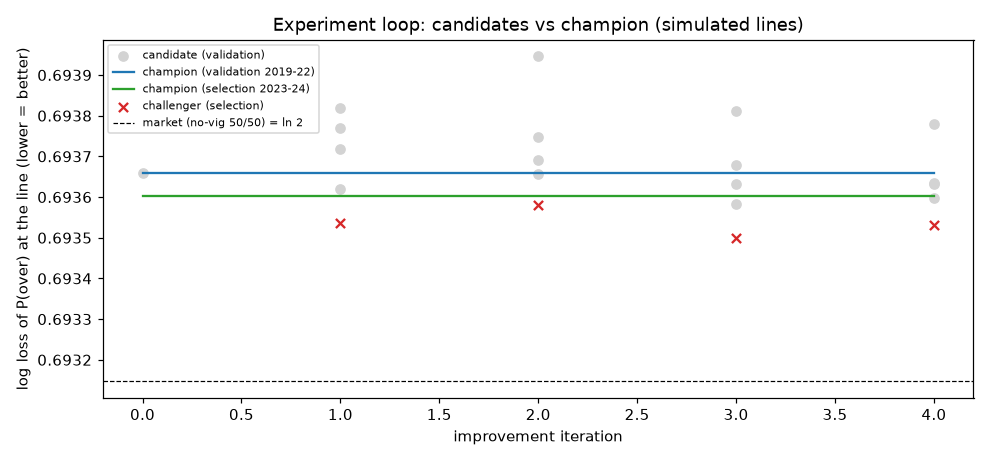

# NFL player-prop research pipeline — summary report

> **Read this first.** There are no real historical prop odds for 2015-2024 in this pipeline. All betting metrics for
> 2019-2024 (and the "sim" holdout) are against **SIMULATED** sharp lines and **cannot prove real-world profitability**.
> The only real-odds test is the 2025 holdout against ESPN BET opening lines (weeks 1-13, one book).

## Data actually used
* nflverse weekly player stats + snap counts + schedules (spread/total/rest/roof/QB starters), seasons
  **2015–2025** (REG + POST as history; bets on REG only),
  75,437 offensive player-game rows. 2026 is in progress and is not used.
* Walk-forward periods: validation [2019, 2020, 2021, 2022], selection [2023, 2024], untouched holdout 2025.
* Simulated-line calibration (default sim, fit on pre-validation seasons only): `{"pass_yds": {"w": 0.173, "c": 0.9779, "calib_ratio": 0.82, "calib_over_rate": 0.4545, "calib_seasons": [2017, 2018]}, "rush_yds": {"w": 0.044, "c": 0.8139, "calib_ratio": 0.93, "calib_over_rate": 0.4972, "calib_seasons": [2017, 2018]}, "rec_yds": {"w": 0.0227, "c": 0.7718, "calib_ratio": 0.93, "calib_over_rate": 0.494, "calib_seasons": [2017, 2018]}}`
  (w = weight on the "inside info" shift, c = public-projection median multiplier; ref_share =
  0.5).

## Leakage check — PASS
```
[PASS] cutoff 2019-11-10: 29,840 rows checked (269 on the cutoff day itself), 0 feature values changed; post-cutoff feature values changed by scramble: 2,649,813
[PASS] cutoff 2022-09-11: 47,150 rows checked (349 on the cutoff day itself), 0 feature values changed; post-cutoff feature values changed by scramble: 1,632,925
[PASS] cutoff 2024-12-22: 67,057 rows checked (295 on the cutoff day itself), 0 feature values changed; post-cutoff feature values changed by scramble: 458,873
[PASS] max |corr(feature, passing_yards)| = 0.926 (is_starting_qb)
[PASS] max |corr(feature, rushing_yards)| = 0.763 (mkt_proj_rush_yds)
[PASS] max |corr(feature, receiving_yards)| = 0.661 (p_receiving_yards_ewm6)
```

## Improvement loop (experiments/runs.jsonl, experiments/champion.json)


|   iter | event                                    | best candidate change                                       | val LL chal / champ   | sel LL chal / champ   | sel gain   | P(gain>0)   | sel flat ROI chal / champ   |
|-------:|:-----------------------------------------|:------------------------------------------------------------|:----------------------|:----------------------|:-----------|:------------|:----------------------------|
|      0 | initial champion                         |                                                             | – / –                 | – / –                 | –          | –           | – / –                       |
|      1 | challenger rejected on selection seasons | model.lgbm.learning_rate=0.015                              | 0.69362 / 0.69366     | 0.69354 / 0.69360     | 0.00007    | 0.819       | – / –                       |
|      2 | challenger rejected on selection seasons | model.feature_set=player_vegas, model.lgbm.n_estimators=200 | 0.69366 / 0.69366     | 0.69358 / 0.69360     | 0.00002    | 0.571       | – / –                       |
|      3 | challenger rejected on selection seasons | model.lgbm.min_child_samples=20                             | 0.69358 / 0.69366     | 0.69350 / 0.69360     | 0.00010    | 0.951       | – / –                       |
|      4 | challenger rejected on selection seasons | model.lgbm.num_leaves=7                                     | 0.69360 / 0.69366     | 0.69353 / 0.69360     | 0.00007    | 0.824       | – / –                       |

All candidates (validation 2019-2022, betting params tuned on validation only):

| run_id   |   iteration | changes                                                      |   metrics.logloss |   metrics.flat_roi |   metrics.n_bets |   metrics.mae_model |   betting.market_blend |   betting.edge_threshold |   betting.kelly_fraction |
|:---------|------------:|:-------------------------------------------------------------|------------------:|-------------------:|-----------------:|--------------------:|-----------------------:|-------------------------:|-------------------------:|
| r0003    |           1 | model.use_snaps=False                                        |          0.69377  |                nan |                0 |             29.3822 |                    0.9 |                        1 |                      0.1 |
| r0004    |           1 | model.retrain_every_weeks=8, model.lgbm.n_estimators=800     |          0.69382  |                nan |                0 |             29.6421 |                    0.9 |                        1 |                      0.1 |
| r0005    |           1 | model.lgbm.learning_rate=0.015                               |          0.693621 |                nan |                0 |             29.1379 |                    0.9 |                        1 |                      0.1 |
| r0006    |           1 | model.lgbm.colsample_bytree=0.5                              |          0.693718 |                nan |                0 |             29.3383 |                    0.9 |                        1 |                      0.1 |
| r0008    |           2 | model.dist=normal                                            |          0.693691 |                nan |                0 |             29.3184 |                    0.9 |                        1 |                      0.1 |
| r0009    |           2 | model.lgbm.colsample_bytree=1.0, model.retrain_every_weeks=8 |          0.693747 |                nan |                0 |             29.3593 |                    0.9 |                        1 |                      0.1 |
| r0010    |           2 | model.feature_set=player_vegas, model.lgbm.n_estimators=200  |          0.693656 |                nan |                0 |             29.2605 |                    0.9 |                        1 |                      0.1 |
| r0011    |           2 | model.use_snaps=False, model.lgbm.num_leaves=31              |          0.693946 |                nan |                0 |             29.6379 |                    0.9 |                        1 |                      0.1 |
| r0013    |           3 | model.dist=normal, model.lgbm.n_estimators=800               |          0.693813 |                nan |                0 |             29.6556 |                    0.9 |                        1 |                      0.1 |
| r0014    |           3 | model.lgbm.min_child_samples=20                              |          0.693583 |                nan |                0 |             29.2825 |                    0.9 |                        1 |                      0.1 |
| r0015    |           3 | model.lgbm.n_estimators=800, model.feature_set=player_vegas  |          0.69368  |                nan |                0 |             29.779  |                    0.9 |                        1 |                      0.1 |
| r0016    |           3 | model.lgbm.learning_rate=0.015, model.dist=normal            |          0.693631 |                nan |                0 |             29.1379 |                    0.9 |                        1 |                      0.1 |
| r0018    |           4 | model.feature_set=player_vegas                               |          0.693633 |                nan |                0 |             29.4414 |                    0.9 |                        1 |                      0.1 |
| r0019    |           4 | model.lgbm.num_leaves=7                                      |          0.693597 |                nan |                0 |             29.1467 |                    0.9 |                        1 |                      0.1 |
| r0020    |           4 | model.lgbm.num_leaves=31, model.lgbm.colsample_bytree=0.5    |          0.693779 |                nan |                0 |             29.5087 |                    0.9 |                        1 |                      0.1 |
| r0021    |           4 | model.lgbm.n_estimators=200                                  |          0.693634 |                nan |                0 |             29.1642 |                    0.9 |                        1 |                      0.1 |

Current champion `63785e6609`: model `{"feature_set": "full", "use_snaps": true, "use_market_proj": true, "dist": "empirical", "retrain_every_weeks": 4, "n_folds": 3, "lgbm": {"n_estimators": 400, "learning_rate": 0.03, "num_leaves": 15, "min_child_samples": 50, "colsample_bytree": 0.8, "reg_lambda": 1.0}}`; betting `{"market_blend": 0.9, "edge_threshold": 1.0, "kelly_fraction": 0.1, "val_logloss": 0.6936601998388586, "val_log_growth": NaN, "no_bet": true}`.

## Champion walk-forward 2019-2024 (SIMULATED lines)
Full report: `reports/champion_walkforward_2019_2024_sim/report.md`

| market | lines | bets (O/U) | hit rate | flat ROI (95% CI) | Kelly ROI | Brier model / mkt | log loss model / mkt | MAE model | MAE naive EWMA | MAE public proj | MAE line | CRPS |
|---|---|---|---|---|---|---|---|---|---|---|---|---|
| pass_yds | 3077 | 0 (0/0) | – | – ± – | – | 0.2515 / 0.2500 | 0.6962 / 0.6931 | 60.32 | 67.84 | 68.39 | 55.39 | 43.59 |
| rec_yds | 14063 | 0 (0/0) | – | – ± – | – | 0.2499 / 0.2500 | 0.6930 / 0.6931 | 24.03 | 25.53 | 25.20 | 23.52 | 16.86 |
| rush_yds | 5384 | 0 (0/0) | – | – ± – | – | 0.2504 / 0.2500 | 0.6939 / 0.6931 | 25.13 | 26.17 | 26.01 | 24.21 | 17.77 |
| ALL | 22524 | 0 (0/0) | – | – ± – | – | 0.2502 / 0.2500 | 0.6936 / 0.6931 | 29.25 | 31.46 | 31.30 | 28.04 | 20.73 |


## Diagnostic fixed policy (not tuned): market_blend=0.5, edge_threshold=0.04, kelly_fraction=0.25

Bankroll 1000 → 50, max drawdown -95.0%.

| market | lines | bets (O/U) | hit rate | flat ROI (95% CI) | Kelly ROI | Brier model / mkt | log loss model / mkt | MAE model | MAE naive EWMA | MAE public proj | MAE line | CRPS |
|---|---|---|---|---|---|---|---|---|---|---|---|---|
| pass_yds | 3077 | 1244 (814/430) | 41.0% | -21.7% ± 5.2% | -28.1% | 0.2598 / 0.2500 | 0.7130 / 0.6931 | 60.32 | 67.84 | 68.39 | 55.39 | 43.59 |
| rec_yds | 14063 | 1376 (778/598) | 52.7% | 0.6% ± 5.0% | 0.8% | 0.2501 / 0.2500 | 0.6933 / 0.6931 | 24.03 | 25.53 | 25.20 | 23.52 | 16.86 |
| rush_yds | 5384 | 975 (497/478) | 44.5% | -15.0% ± 6.0% | -19.5% | 0.2527 / 0.2500 | 0.6985 / 0.6931 | 25.13 | 26.17 | 26.01 | 24.21 | 17.77 |
| ALL | 22524 | 3595 (2089/1506) | 46.4% | -11.4% ± 3.1% | -15.5% | 0.2520 / 0.2500 | 0.6972 / 0.6931 | 29.25 | 31.46 | 31.30 | 28.04 | 20.73 |


Selection seasons only ([2023, 2024]), which were not used to tune anything for this champion — tuned policy:

| market | lines | bets (O/U) | hit rate | flat ROI (95% CI) | Kelly ROI | Brier model / mkt | log loss model / mkt | MAE model | MAE naive EWMA | MAE public proj | MAE line | CRPS |
|---|---|---|---|---|---|---|---|---|---|---|---|---|
| pass_yds | 1032 | 0 (0/0) | – | – ± – | – | 0.2515 / 0.2500 | 0.6961 / 0.6931 | 60.48 | 68.06 | 68.90 | 55.92 | 43.37 |
| rec_yds | 4543 | 0 (0/0) | – | – ± – | – | 0.2499 / 0.2500 | 0.6929 / 0.6931 | 23.91 | 25.52 | 25.01 | 23.57 | 16.87 |
| rush_yds | 1814 | 0 (0/0) | – | – ± – | – | 0.2504 / 0.2500 | 0.6939 / 0.6931 | 24.28 | 25.08 | 24.83 | 23.30 | 17.09 |
| ALL | 7389 | 0 (0/0) | – | – ± – | – | 0.2502 / 0.2500 | 0.6936 / 0.6931 | 29.11 | 31.35 | 31.10 | 28.02 | 20.63 |


## Diagnostic fixed policy (not tuned): market_blend=0.5, edge_threshold=0.04, kelly_fraction=0.25

Bankroll 1000 → 360, max drawdown -64.2%.

| market | lines | bets (O/U) | hit rate | flat ROI (95% CI) | Kelly ROI | Brier model / mkt | log loss model / mkt | MAE model | MAE naive EWMA | MAE public proj | MAE line | CRPS |
|---|---|---|---|---|---|---|---|---|---|---|---|---|
| pass_yds | 1032 | 409 (286/123) | 42.1% | -19.7% ± 9.1% | -23.5% | 0.2595 / 0.2500 | 0.7125 / 0.6931 | 60.48 | 68.06 | 68.90 | 55.92 | 43.37 |
| rec_yds | 4543 | 414 (253/161) | 52.9% | 1.0% ± 9.2% | 2.5% | 0.2499 / 0.2500 | 0.6930 / 0.6931 | 23.91 | 25.52 | 25.01 | 23.57 | 16.87 |
| rush_yds | 1814 | 286 (154/132) | 41.6% | -20.6% ± 10.9% | -21.7% | 0.2525 / 0.2500 | 0.6982 / 0.6931 | 24.28 | 25.08 | 24.83 | 23.30 | 17.09 |
| ALL | 7389 | 1109 (693/416) | 46.0% | -12.2% ± 5.6% | -14.4% | 0.2519 / 0.2500 | 0.6970 / 0.6931 | 29.11 | 31.35 | 31.10 | 28.02 | 20.63 |


## Sensitivity: how the selection-period result depends on the simulated market's sharpness
| simulated market                                                                 | policy     |   bets | hit rate   | flat ROI   | log loss model / mkt   |   final bankroll |
|:---------------------------------------------------------------------------------|:-----------|-------:|:-----------|:-----------|:-----------------------|-----------------:|
| ref_share=0.0: market = simple public projection + inside info (soft)            | tuned      |      0 | –          | –          | 0.6915 / 0.6931        |             1000 |
| ref_share=0.0: market = simple public projection + inside info (soft)            | diagnostic |   3136 | 55.1%      | 5.3%       | 0.6896 / 0.6931        |             1535 |
| ref_share=0.5 (DEFAULT)                                                          | tuned      |      0 | –          | –          | 0.6936 / 0.6931        |             1000 |
| ref_share=0.5 (DEFAULT)                                                          | diagnostic |   1109 | 46.0%      | -12.2%     | 0.6970 / 0.6931        |              360 |
| ref_share=1.0: market knows everything a strong public model knows + inside info | tuned      |      0 | –          | –          | 0.6951 / 0.6931        |             1000 |
| ref_share=1.0: market knows everything a strong public model knows + inside info | diagnostic |    941 | 37.1%      | -29.2%     | 0.7049 / 0.6931        |              114 |

## Holdout 2025 (champion only, nothing re-tuned)
* **sim** (SIMULATED lines): 0 bets, hit –, flat ROI –, bankroll 1000 → 1000 (max DD 0.0%), log loss 0.6937 vs market 0.6931; MAE model 28.38 vs line 26.91. Report: `/workspace/nfl-props/reports/holdout_2025_sim/report.md`
    * diagnostic fixed policy: 538 bets, hit 45.2%, flat ROI -13.8%, bankroll 1000 → 590
        * pass_yds: 212 bets, hit 40.1%, flat ROI -23.5%
        * rec_yds: 174 bets, hit 52.3%, flat ROI -0.2%
        * rush_yds: 152 bets, hit 44.1%, flat ROI -15.8%
    * tuned policy per market / forecast quality:
        * pass_yds: 0 bets, hit –, flat ROI –, LL 0.6967 vs mkt 0.6931, MAE model 58.38 / line 53.75
        * rec_yds: 0 bets, hit –, flat ROI –, LL 0.6930 vs mkt 0.6931, MAE model 22.86 / line 21.99
        * rush_yds: 0 bets, hit –, flat ROI –, LL 0.6936 vs mkt 0.6931, MAE model 24.76 / line 23.62
* **real_espn_open** (REAL ESPN BET opening lines, 2025 wk 1-13): 0 bets, hit –, flat ROI –, bankroll 1000 → 1000 (max DD 0.0%), log loss 0.6903 vs market 0.6912; MAE model 28.38 vs line 27.59. Report: `/workspace/nfl-props/reports/holdout_2025_real_espn_open/report.md`
    * diagnostic fixed policy: 995 bets, hit 54.9%, flat ROI 3.0%, bankroll 1000 → 1052
        * pass_yds: 163 bets, hit 54.0%, flat ROI 2.8%
        * rec_yds: 551 bets, hit 56.3%, flat ROI 5.3%
        * rush_yds: 281 bets, hit 52.7%, flat ROI -1.4%
    * tuned policy per market / forecast quality:
        * pass_yds: 0 bets, hit –, flat ROI –, LL 0.6897 vs mkt 0.6905, MAE model 58.38 / line 54.36
        * rec_yds: 0 bets, hit –, flat ROI –, LL 0.6903 vs mkt 0.6913, MAE model 22.86 / line 22.40
        * rush_yds: 0 bets, hit –, flat ROI –, LL 0.6909 vs mkt 0.6913, MAE model 24.76 / line 24.12

**Simulated vs real lines on the same 2025 player-games** (how realistic is the simulator?):

|          |   n_overlap |   mae_sim_line |   mae_real_line |   mae_model_mean |   over_rate_sim |   over_rate_real |   mean_sim_minus_real |   corr_sim_real |
|:---------|------------:|---------------:|----------------:|-----------------:|----------------:|-----------------:|----------------------:|----------------:|
| pass_yds |         355 |         52.432 |          54.362 |           56.206 |           0.499 |            0.499 |                -4.296 |           0.744 |
| rec_yds  |        1462 |         22.384 |          22.403 |           23.19  |           0.488 |            0.473 |                -2.659 |           0.907 |
| rush_yds |         556 |         24.59  |          24.121 |           25.704 |           0.518 |            0.455 |                -5.061 |           0.882 |

**Is the real-line signal distinguishable from noise?** Paired week-block bootstrap of the log-loss gain of the model's P(over) over the real no-vig market probability (2025 wk 1-13):

|   market_blend |   LL gain vs market (nats/line) | bootstrap 90% interval   |   P(gain > 0) |
|---------------:|--------------------------------:|:-------------------------|--------------:|
|            0   |                        -0.01311 | [-0.02289, -0.00349]     |         0.013 |
|            0.5 |                        -0.00012 | [-0.00504, 0.00488]      |         0.481 |
|            0.9 |                         0.00088 | [-0.00013, 0.00193]      |         0.922 |

Diagnostic-policy flat ROI on real lines: 3.0% ± 5.9% (95% CI, 995 bets, 363 overs / 632 unders).

