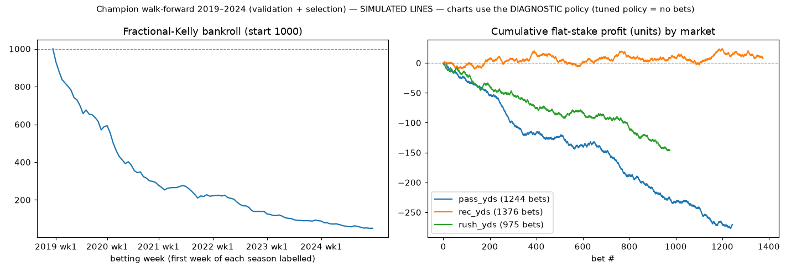
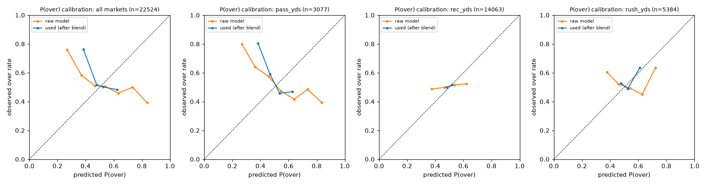
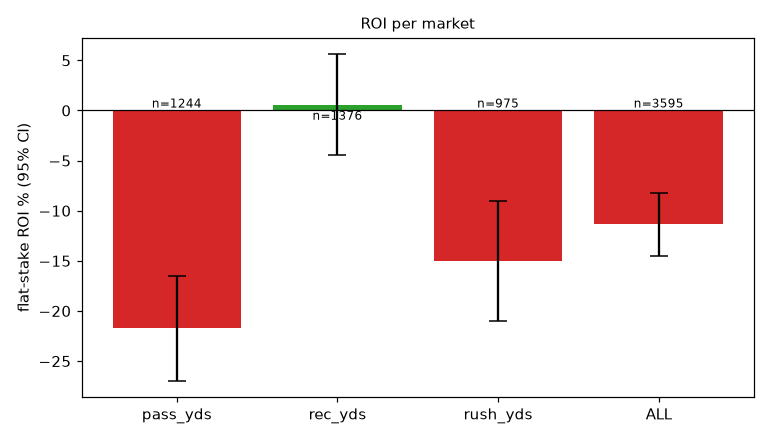

# Champion walk-forward 2019–2024 (validation + selection)

> **SIMULATED LINES.** Every betting number below is measured against *simulated* sharp-market lines (see README, 'Simulated lines'). They are a research stress-test, **not evidence of real-world profitability**.

* seasons: [2019, 2020, 2021, 2022, 2023, 2024]  |  line source: `simulated_sharp`
* **tuned policy = DON'T BET** (no betting params grew the bankroll on the validation seasons); bet-level numbers below come from the diagnostic fixed policy section
* betting params: market_blend=0.9, edge_threshold=1.0, kelly_fraction=0.1, max_bet_frac=0.02, max_week_exposure=0.2
* bankroll: 1000 → **1000**, max drawdown **0.0%**, turnover 0
* model: `{"feature_set": "full", "use_snaps": true, "use_market_proj": true, "dist": "empirical", "retrain_every_weeks": 4, "n_folds": 3, "lgbm": {"n_estimators": 400, "learning_rate": 0.03, "num_leaves": 15, "min_child_samples": 50, "colsample_bytree": 0.8, "reg_lambda": 1.0}}`

## Per market

| market | lines | bets (O/U) | hit rate | flat ROI (95% CI) | Kelly ROI | Brier model / mkt | log loss model / mkt | MAE model | MAE naive EWMA | MAE public proj | MAE line | CRPS |
|---|---|---|---|---|---|---|---|---|---|---|---|---|
| pass_yds | 3077 | 0 (0/0) | – | – ± – | – | 0.2515 / 0.2500 | 0.6962 / 0.6931 | 60.32 | 67.84 | 68.39 | 55.39 | 43.59 |
| rec_yds | 14063 | 0 (0/0) | – | – ± – | – | 0.2499 / 0.2500 | 0.6930 / 0.6931 | 24.03 | 25.53 | 25.20 | 23.52 | 16.86 |
| rush_yds | 5384 | 0 (0/0) | – | – ± – | – | 0.2504 / 0.2500 | 0.6939 / 0.6931 | 25.13 | 26.17 | 26.01 | 24.21 | 17.77 |
| ALL | 22524 | 0 (0/0) | – | – ± – | – | 0.2502 / 0.2500 | 0.6936 / 0.6931 | 29.25 | 31.46 | 31.30 | 28.04 | 20.73 |

Brier/log loss are for P(over) on **every** priced line (not just bets); the market column is the no-vig implied probability. A model has real information beyond the line only if its Brier/log loss is *below* the market's. MAE columns compare the model mean to a naive EWMA, the public projection and the line.

## Per season

| season | lines | bets | hit rate | flat ROI | log loss model / mkt | MAE model / naive |
|---|---|---|---|---|---|---|
| 2019 | 3597 | 0 | – | – | 0.6939 / 0.6931 | 30.56 / 32.01 |
| 2020 | 3840 | 0 | – | – | 0.6938 / 0.6931 | 29.24 / 31.29 |
| 2021 | 3938 | 0 | – | – | 0.6934 / 0.6931 | 28.70 / 31.38 |
| 2022 | 3760 | 0 | – | – | 0.6936 / 0.6931 | 28.86 / 31.40 |
| 2023 | 3711 | 0 | – | – | 0.6935 / 0.6931 | 29.26 / 31.68 |
| 2024 | 3678 | 0 | – | – | 0.6937 / 0.6931 | 28.95 / 31.02 |

## Reliability (all markets, P(over) used for betting)

| bin mean pred | observed over rate | n |
|---|---|---|
| 0.496 | 0.518 | 10560 |
| 0.505 | 0.501 | 11964 |

## Charts

## Diagnostic fixed policy (not tuned): market_blend=0.5, edge_threshold=0.04, kelly_fraction=0.25

Bankroll 1000 → 50, max drawdown -95.0%.

| market | lines | bets (O/U) | hit rate | flat ROI (95% CI) | Kelly ROI | Brier model / mkt | log loss model / mkt | MAE model | MAE naive EWMA | MAE public proj | MAE line | CRPS |
|---|---|---|---|---|---|---|---|---|---|---|---|---|
| pass_yds | 3077 | 1244 (814/430) | 41.0% | -21.7% ± 5.2% | -28.1% | 0.2598 / 0.2500 | 0.7130 / 0.6931 | 60.32 | 67.84 | 68.39 | 55.39 | 43.59 |
| rec_yds | 14063 | 1376 (778/598) | 52.7% | 0.6% ± 5.0% | 0.8% | 0.2501 / 0.2500 | 0.6933 / 0.6931 | 24.03 | 25.53 | 25.20 | 23.52 | 16.86 |
| rush_yds | 5384 | 975 (497/478) | 44.5% | -15.0% ± 6.0% | -19.5% | 0.2527 / 0.2500 | 0.6985 / 0.6931 | 25.13 | 26.17 | 26.01 | 24.21 | 17.77 |
| ALL | 22524 | 3595 (2089/1506) | 46.4% | -11.4% ± 3.1% | -15.5% | 0.2520 / 0.2500 | 0.6972 / 0.6931 | 29.25 | 31.46 | 31.30 | 28.04 | 20.73 |

