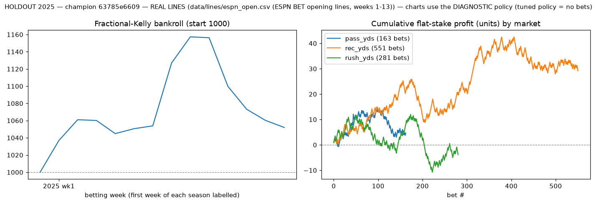
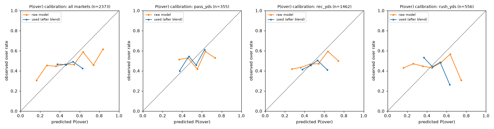
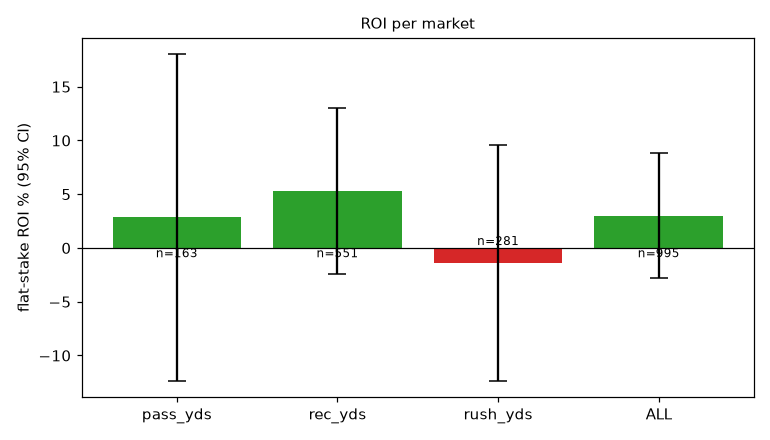

# HOLDOUT 2025 — champion 63785e6609

> **REAL LINES** (data/lines/espn_open.csv (ESPN BET opening lines, weeks 1-13)). Small sample — treat ROI confidence intervals seriously.

* seasons: [2025]  |  line source: `data/lines/espn_open.csv (ESPN BET opening lines, weeks 1-13)`
* **tuned policy = DON'T BET** (no betting params grew the bankroll on the validation seasons); bet-level numbers below come from the diagnostic fixed policy section
* betting params: market_blend=0.9, edge_threshold=1.0, kelly_fraction=0.1, max_bet_frac=0.02, max_week_exposure=0.2
* bankroll: 1000 → **1000**, max drawdown **0.0%**, turnover 0
* model: `{"feature_set": "full", "use_snaps": true, "use_market_proj": true, "dist": "empirical", "retrain_every_weeks": 4, "n_folds": 3, "lgbm": {"n_estimators": 400, "learning_rate": 0.03, "num_leaves": 15, "min_child_samples": 50, "colsample_bytree": 0.8, "reg_lambda": 1.0}}`

## Per market

| market | lines | bets (O/U) | hit rate | flat ROI (95% CI) | Kelly ROI | Brier model / mkt | log loss model / mkt | MAE model | MAE naive EWMA | MAE public proj | MAE line | CRPS |
|---|---|---|---|---|---|---|---|---|---|---|---|---|
| pass_yds | 355 | 0 (0/0) | – | – ± – | – | 0.2486 / 0.2490 | 0.6897 / 0.6905 | 58.38 | 65.89 | 65.81 | 54.36 | 41.50 |
| rec_yds | 1462 | 0 (0/0) | – | – ± – | – | 0.2485 / 0.2490 | 0.6903 / 0.6913 | 22.86 | 24.44 | 24.10 | 22.40 | 15.89 |
| rush_yds | 556 | 0 (0/0) | – | – ± – | – | 0.2489 / 0.2491 | 0.6909 / 0.6913 | 24.76 | 25.94 | 25.63 | 24.12 | 17.56 |
| ALL | 2373 | 0 (0/0) | – | – ± – | – | 0.2486 / 0.2490 | 0.6903 / 0.6912 | 28.38 | 30.70 | 30.41 | 27.59 | 19.94 |

Brier/log loss are for P(over) on **every** priced line (not just bets); the market column is the no-vig implied probability. A model has real information beyond the line only if its Brier/log loss is *below* the market's. MAE columns compare the model mean to a naive EWMA, the public projection and the line.

## Per season

| season | lines | bets | hit rate | flat ROI | log loss model / mkt | MAE model / naive |
|---|---|---|---|---|---|---|
| 2025 | 2373 | 0 | – | – | 0.6903 / 0.6912 | 28.38 / 30.70 |

## Reliability (all markets, P(over) used for betting)

| bin mean pred | observed over rate | n |
|---|---|---|
| 0.082 | 0.333 | 3 |
| 0.159 | 0.143 | 7 |
| 0.249 | 0.250 | 4 |
| 0.352 | 0.250 | 8 |
| 0.488 | 0.472 | 1307 |
| 0.511 | 0.475 | 1030 |
| 0.642 | 0.500 | 8 |
| 0.766 | 1.000 | 2 |
| 0.813 | 1.000 | 3 |
| 0.921 | 1.000 | 1 |

## Charts

## Diagnostic fixed policy (not tuned): market_blend=0.5, edge_threshold=0.04, kelly_fraction=0.25

Bankroll 1000 → 1052, max drawdown -9.1%.

| market | lines | bets (O/U) | hit rate | flat ROI (95% CI) | Kelly ROI | Brier model / mkt | log loss model / mkt | MAE model | MAE naive EWMA | MAE public proj | MAE line | CRPS |
|---|---|---|---|---|---|---|---|---|---|---|---|---|
| pass_yds | 355 | 163 (104/59) | 54.0% | 2.8% ± 15.2% | 1.7% | 0.2494 / 0.2490 | 0.6913 / 0.6905 | 58.38 | 65.89 | 65.81 | 54.36 | 41.50 |
| rec_yds | 1462 | 551 (183/368) | 56.3% | 5.3% ± 7.8% | 4.8% | 0.2482 / 0.2490 | 0.6895 / 0.6913 | 22.86 | 24.44 | 24.10 | 22.40 | 15.89 |
| rush_yds | 556 | 281 (76/205) | 52.7% | -1.4% ± 11.0% | -3.0% | 0.2514 / 0.2491 | 0.6961 / 0.6913 | 24.76 | 25.94 | 25.63 | 24.12 | 17.56 |
| ALL | 2373 | 995 (363/632) | 54.9% | 3.0% ± 5.9% | 1.9% | 0.2491 / 0.2490 | 0.6913 / 0.6912 | 28.38 | 30.70 | 30.41 | 27.59 | 19.94 |

