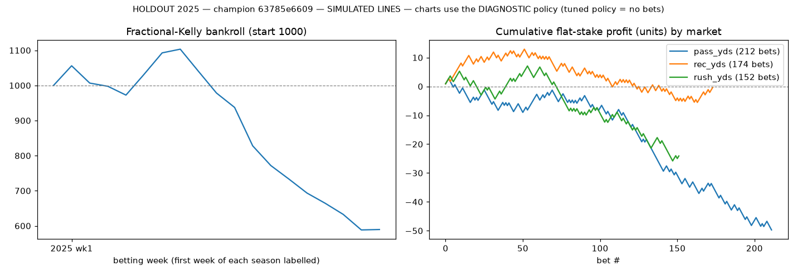
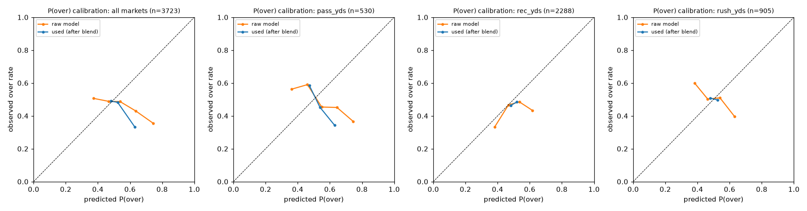
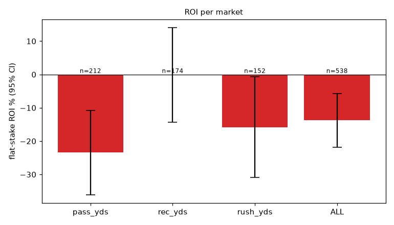

# HOLDOUT 2025 — champion 63785e6609

> **SIMULATED LINES.** Every betting number below is measured against *simulated* sharp-market lines (see README, 'Simulated lines'). They are a research stress-test, **not evidence of real-world profitability**.

* seasons: [2025]  |  line source: `simulated_sharp`
* **tuned policy = DON'T BET** (no betting params grew the bankroll on the validation seasons); bet-level numbers below come from the diagnostic fixed policy section
* betting params: market_blend=0.9, edge_threshold=1.0, kelly_fraction=0.1, max_bet_frac=0.02, max_week_exposure=0.2
* bankroll: 1000 → **1000**, max drawdown **0.0%**, turnover 0
* model: `{"feature_set": "full", "use_snaps": true, "use_market_proj": true, "dist": "empirical", "retrain_every_weeks": 4, "n_folds": 3, "lgbm": {"n_estimators": 400, "learning_rate": 0.03, "num_leaves": 15, "min_child_samples": 50, "colsample_bytree": 0.8, "reg_lambda": 1.0}}`

## Per market

| market | lines | bets (O/U) | hit rate | flat ROI (95% CI) | Kelly ROI | Brier model / mkt | log loss model / mkt | MAE model | MAE naive EWMA | MAE public proj | MAE line | CRPS |
|---|---|---|---|---|---|---|---|---|---|---|---|---|
| pass_yds | 530 | 0 (0/0) | – | – ± – | – | 0.2518 / 0.2500 | 0.6967 / 0.6931 | 58.38 | 65.89 | 65.81 | 53.75 | 41.50 |
| rec_yds | 2288 | 0 (0/0) | – | – ± – | – | 0.2499 / 0.2500 | 0.6930 / 0.6931 | 22.86 | 24.44 | 24.10 | 21.99 | 15.89 |
| rush_yds | 905 | 0 (0/0) | – | – ± – | – | 0.2502 / 0.2500 | 0.6936 / 0.6931 | 24.76 | 25.94 | 25.63 | 23.62 | 17.56 |
| ALL | 3723 | 0 (0/0) | – | – ± – | – | 0.2503 / 0.2500 | 0.6937 / 0.6931 | 28.38 | 30.70 | 30.41 | 26.91 | 19.94 |

Brier/log loss are for P(over) on **every** priced line (not just bets); the market column is the no-vig implied probability. A model has real information beyond the line only if its Brier/log loss is *below* the market's. MAE columns compare the model mean to a naive EWMA, the public projection and the line.

## Per season

| season | lines | bets | hit rate | flat ROI | log loss model / mkt | MAE model / naive |
|---|---|---|---|---|---|---|
| 2025 | 3723 | 0 | – | – | 0.6937 / 0.6931 | 28.38 / 30.70 |

## Reliability (all markets, P(over) used for betting)

| bin mean pred | observed over rate | n |
|---|---|---|
| 0.496 | 0.490 | 1668 |
| 0.505 | 0.480 | 2055 |

## Charts

## Diagnostic fixed policy (not tuned): market_blend=0.5, edge_threshold=0.04, kelly_fraction=0.25

Bankroll 1000 → 590, max drawdown -46.7%.

| market | lines | bets (O/U) | hit rate | flat ROI (95% CI) | Kelly ROI | Brier model / mkt | log loss model / mkt | MAE model | MAE naive EWMA | MAE public proj | MAE line | CRPS |
|---|---|---|---|---|---|---|---|---|---|---|---|---|
| pass_yds | 530 | 212 (161/51) | 40.1% | -23.5% ± 12.6% | -21.1% | 0.2612 / 0.2500 | 0.7159 / 0.6931 | 58.38 | 65.89 | 65.81 | 53.75 | 41.50 |
| rec_yds | 2288 | 174 (91/83) | 52.3% | -0.2% ± 14.2% | 1.7% | 0.2500 / 0.2500 | 0.6932 / 0.6931 | 22.86 | 24.44 | 24.10 | 21.99 | 15.89 |
| rush_yds | 905 | 152 (98/54) | 44.1% | -15.8% ± 15.1% | -13.0% | 0.2518 / 0.2500 | 0.6968 / 0.6931 | 24.76 | 25.94 | 25.63 | 23.62 | 17.56 |
| ALL | 3723 | 538 (350/188) | 45.2% | -13.8% ± 8.0% | -12.7% | 0.2521 / 0.2500 | 0.6973 / 0.6931 | 28.38 | 30.70 | 30.41 | 26.91 | 19.94 |

