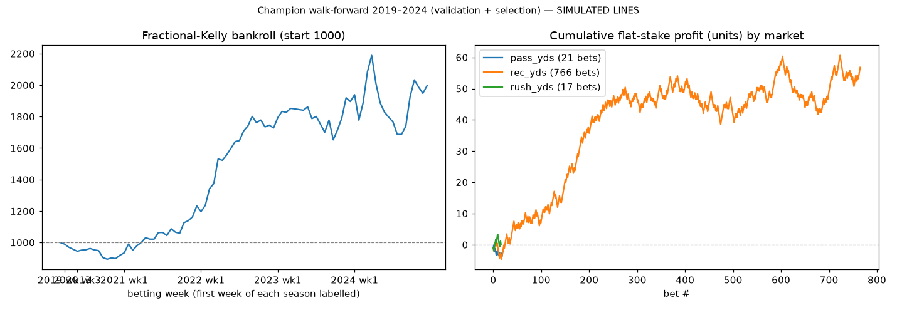
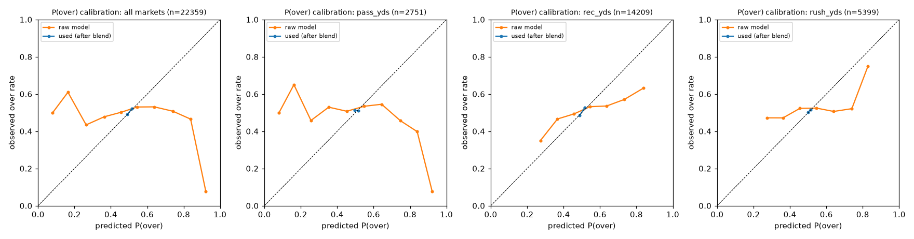
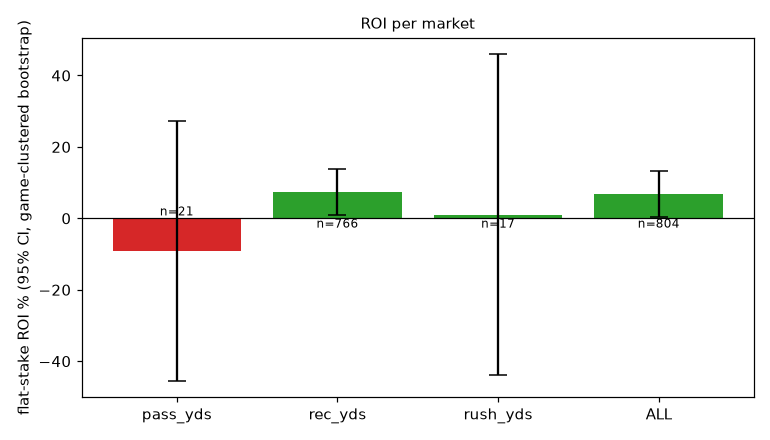

# Champion walk-forward 2019–2024 (validation + selection)

> **SIMULATED LINES.** Every betting number below is measured against *simulated* sharp-market lines (see README, 'Simulated lines'). They are a research stress-test, **not evidence of real-world profitability**.

* seasons: [2019, 2020, 2021, 2022, 2023, 2024]  |  line source: `simulated_sharp`

* betting params: probabilities=stacker, edge_threshold=0.04, kelly_fraction=0.25, caps: bet 0.02, game 0.04 (max 3 bets), team-game 0.03, 1 bet/player-game, week 0.2
* bankroll: 1000 → **1997**, max drawdown **-22.9%**, turnover 16406
* model: `{"feature_set": "full", "use_snaps": true, "use_market_proj": true, "dist": "empirical", "retrain_every_weeks": 4, "n_folds": 3, "lgbm": {"n_estimators": 400, "learning_rate": 0.03, "num_leaves": 7, "min_child_samples": 50, "colsample_bytree": 0.8, "reg_lambda": 1.0}}`

## Per market

| market | lines | bets (O/U) | hit rate | flat ROI [95% CI, game-clustered] | Kelly ROI | Brier used / mkt | log loss raw model / used / mkt | MAE model | MAE naive EWMA | MAE public proj | MAE line | CRPS |
|---|---|---|---|---|---|---|---|---|---|---|---|---|
| pass_yds | 2751 | 21 (20/1) | 47.6% | -9.1% [-45.5%, 27.3%] | -11.1% | 0.2500 / 0.2500 | 0.7762 / 0.6932 / 0.6931 | 61.52 | 64.66 | 64.63 | 53.19 | 44.42 |
| rec_yds | 14209 | 766 (565/201) | 56.3% | 7.4% [0.9%, 13.9%] | 6.5% | 0.2494 / 0.2500 | 0.6994 / 0.6919 / 0.6931 | 23.99 | 25.47 | 25.15 | 23.29 | 16.80 |
| rush_yds | 5399 | 17 (17/0) | 52.9% | 1.1% [-43.9%, 46.0%] | 6.8% | 0.2498 / 0.2500 | 0.7071 / 0.6928 / 0.6931 | 25.04 | 26.17 | 26.05 | 24.28 | 17.73 |
| ALL | 22359 | 804 (602/202) | 56.0% | 6.9% [0.3%, 13.2%] | 6.1% | 0.2496 / 0.2500 | 0.7107 / 0.6923 / 0.6931 | 28.86 | 30.46 | 30.22 | 27.21 | 20.42 |

Brier/log loss are for P(over) on **every** priced line (not just bets): *raw model* = the distributional model alone, *used* = after the rolling stacker (market probability until a market has enough earlier lines), *mkt* = no-vig implied probability. A model has information beyond the line only if its log loss is *below* the market's. ROI CIs are game-clustered bootstrap intervals. MAE columns compare the model mean to a naive EWMA, the public projection and the line.

## Per season

| season | lines | bets | hit rate | flat ROI | log loss model / mkt | MAE model / naive |
|---|---|---|---|---|---|---|
| 2019 | 3565 | 8 | 37.5% | -28.4% | 0.6934 / 0.6931 | 30.21 / 31.20 |
| 2020 | 3789 | 22 | 45.5% | -13.2% | 0.6923 / 0.6931 | 29.05 / 30.54 |
| 2021 | 3922 | 110 | 61.8% | 18.0% | 0.6921 / 0.6931 | 28.27 / 30.06 |
| 2022 | 3744 | 208 | 59.6% | 13.8% | 0.6919 / 0.6931 | 28.39 / 30.32 |
| 2023 | 3678 | 221 | 53.4% | 1.9% | 0.6917 / 0.6931 | 28.65 / 30.41 |
| 2024 | 3661 | 235 | 54.0% | 3.2% | 0.6923 / 0.6931 | 28.65 / 30.28 |

## Reliability (all markets, P(over) used for betting)

| bin mean pred | observed over rate | n |
|---|---|---|
| 0.490 | 0.490 | 6702 |
| 0.515 | 0.521 | 15650 |
| 0.613 | 0.857 | 7 |

## Charts

## Fixed policy (not tuned; = the pre-declared holdout policy): probabilities=stacker, edge_threshold=0.04, kelly_fraction=0.25, exposure caps as config

Bankroll 1000 → 1997, max drawdown -22.9%.

| market | lines | bets (O/U) | hit rate | flat ROI [95% CI, game-clustered] | Kelly ROI | Brier used / mkt | log loss raw model / used / mkt | MAE model | MAE naive EWMA | MAE public proj | MAE line | CRPS |
|---|---|---|---|---|---|---|---|---|---|---|---|---|
| pass_yds | 2751 | 21 (20/1) | 47.6% | -9.1% [-45.5%, 27.3%] | -11.1% | 0.2500 / 0.2500 | 0.7762 / 0.6932 / 0.6931 | 61.52 | 64.66 | 64.63 | 53.19 | 44.42 |
| rec_yds | 14209 | 766 (565/201) | 56.3% | 7.4% [0.9%, 13.9%] | 6.5% | 0.2494 / 0.2500 | 0.6994 / 0.6919 / 0.6931 | 23.99 | 25.47 | 25.15 | 23.29 | 16.80 |
| rush_yds | 5399 | 17 (17/0) | 52.9% | 1.1% [-43.9%, 46.0%] | 6.8% | 0.2498 / 0.2500 | 0.7071 / 0.6928 / 0.6931 | 25.04 | 26.17 | 26.05 | 24.28 | 17.73 |
| ALL | 22359 | 804 (602/202) | 56.0% | 6.9% [0.3%, 13.2%] | 6.1% | 0.2496 / 0.2500 | 0.7107 / 0.6923 / 0.6931 | 28.86 | 30.46 | 30.22 | 27.21 | 20.42 |

