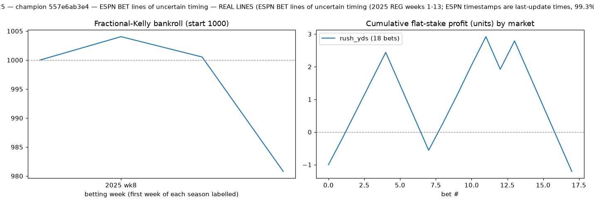
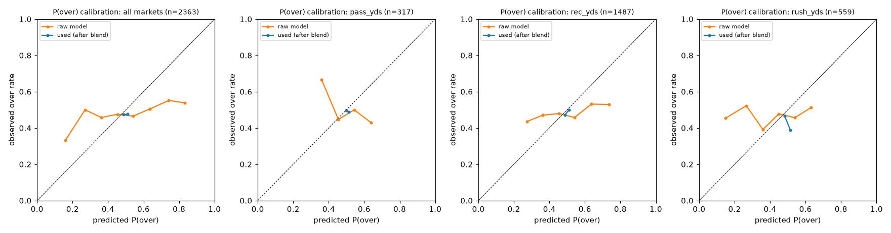
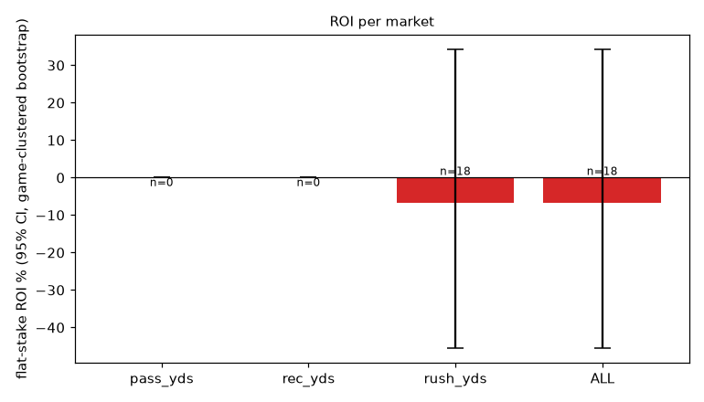

# HOLDOUT 2025 — champion 557e6ab3e4 — ESPN BET lines of uncertain timing

> **REAL LINES** (ESPN BET lines of uncertain timing (2025 REG weeks 1-13; ESPN timestamps are last-update times, 99.3% after kickoff)). Small sample — treat the game-clustered ROI confidence intervals seriously.

* seasons: [2025]  |  line source: `ESPN BET lines of uncertain timing (2025 REG weeks 1-13; ESPN timestamps are last-update times, 99.3% after kickoff)`

* betting params: probabilities=stacker, edge_threshold=0.04, kelly_fraction=0.25, caps: bet 0.02, game 0.04 (max 3 bets), team-game 0.03, 1 bet/player-game, week 0.2
* bankroll: 1000 → **981**, max drawdown **-2.3%**, turnover 106
* model: `{"feature_set": "full", "use_snaps": true, "use_market_proj": true, "dist": "empirical", "retrain_every_weeks": 4, "n_folds": 3, "lgbm": {"n_estimators": 400, "learning_rate": 0.03, "num_leaves": 7, "min_child_samples": 50, "colsample_bytree": 0.8, "reg_lambda": 1.0}}`

## Per market

| market | lines | bets (O/U) | hit rate | flat ROI [95% CI, game-clustered] | Kelly ROI | Brier used / mkt | log loss raw model / used / mkt | MAE model | MAE naive EWMA | MAE public proj | MAE line | CRPS |
|---|---|---|---|---|---|---|---|---|---|---|---|---|
| pass_yds | 317 | 0 (0/0) | – | – [–, –] | – | 0.2485 / 0.2485 | 0.7148 / 0.6895 / 0.6895 | 60.25 | 64.62 | 64.69 | 55.45 | 43.12 |
| rec_yds | 1487 | 0 (0/0) | – | – [–, –] | – | 0.2487 / 0.2491 | 0.7033 / 0.6907 / 0.6915 | 22.93 | 24.31 | 24.09 | 22.39 | 15.90 |
| rush_yds | 559 | 18 (0/18) | 50.0% | -6.7% [-45.4%, 34.2%] | -18.1% | 0.2497 / 0.2492 | 0.7219 / 0.6924 / 0.6913 | 24.76 | 25.84 | 25.68 | 24.08 | 17.51 |
| ALL | 2363 | 18 (0/18) | 50.0% | -6.7% [-45.4%, 34.2%] | -18.1% | 0.2489 / 0.2490 | 0.7093 / 0.6910 / 0.6912 | 28.17 | 29.86 | 29.70 | 27.23 | 19.79 |

Brier/log loss are for P(over) on **every** priced line (not just bets): *raw model* = the distributional model alone, *used* = after the rolling stacker (market probability until a market has enough earlier lines), *mkt* = no-vig implied probability. A model has information beyond the line only if its log loss is *below* the market's. ROI CIs are game-clustered bootstrap intervals. MAE columns compare the model mean to a naive EWMA, the public projection and the line.

## Per season

| season | lines | bets | hit rate | flat ROI | log loss model / mkt | MAE model / naive |
|---|---|---|---|---|---|---|
| 2025 | 2363 | 18 | 50.0% | -6.7% | 0.6910 / 0.6912 | 28.17 / 29.86 |

## Reliability (all markets, P(over) used for betting)

| bin mean pred | observed over rate | n |
|---|---|---|
| 0.074 | 0.333 | 3 |
| 0.151 | 0.250 | 8 |
| 0.246 | 0.000 | 3 |
| 0.342 | 0.250 | 8 |
| 0.487 | 0.473 | 1988 |
| 0.511 | 0.476 | 338 |
| 0.638 | 0.444 | 9 |
| 0.756 | 1.000 | 2 |
| 0.805 | 1.000 | 3 |
| 0.910 | 1.000 | 1 |

## Charts

## Fixed policy (not tuned; = the pre-declared holdout policy): probabilities=stacker, edge_threshold=0.04, kelly_fraction=0.25, exposure caps as config

Bankroll 1000 → 981, max drawdown -2.3%.

| market | lines | bets (O/U) | hit rate | flat ROI [95% CI, game-clustered] | Kelly ROI | Brier used / mkt | log loss raw model / used / mkt | MAE model | MAE naive EWMA | MAE public proj | MAE line | CRPS |
|---|---|---|---|---|---|---|---|---|---|---|---|---|
| pass_yds | 317 | 0 (0/0) | – | – [–, –] | – | 0.2485 / 0.2485 | 0.7148 / 0.6895 / 0.6895 | 60.25 | 64.62 | 64.69 | 55.45 | 43.12 |
| rec_yds | 1487 | 0 (0/0) | – | – [–, –] | – | 0.2487 / 0.2491 | 0.7033 / 0.6907 / 0.6915 | 22.93 | 24.31 | 24.09 | 22.39 | 15.90 |
| rush_yds | 559 | 18 (0/18) | 50.0% | -6.7% [-45.4%, 34.2%] | -18.1% | 0.2497 / 0.2492 | 0.7219 / 0.6924 / 0.6913 | 24.76 | 25.84 | 25.68 | 24.08 | 17.51 |
| ALL | 2363 | 18 (0/18) | 50.0% | -6.7% [-45.4%, 34.2%] | -18.1% | 0.2489 / 0.2490 | 0.7093 / 0.6910 / 0.6912 | 28.17 | 29.86 | 29.70 | 27.23 | 19.79 |

## Stacker coefficients (fit on strictly earlier weeks; c = model weight)

| market   |    n |       a |       b |       c |   week |
|:---------|-----:|--------:|--------:|--------:|-------:|
| pass_yds |    0 | nan     | nan     | nan     |      1 |
| pass_yds |   16 | nan     | nan     | nan     |      2 |
| pass_yds |   43 | nan     | nan     | nan     |      3 |
| pass_yds |   70 | nan     | nan     | nan     |      4 |
| pass_yds |   97 | nan     | nan     | nan     |      5 |
| pass_yds |  120 | nan     | nan     | nan     |      6 |
| pass_yds |  147 | nan     | nan     | nan     |      7 |
| pass_yds |  175 | nan     | nan     | nan     |      8 |
| pass_yds |  196 | nan     | nan     | nan     |      9 |
| pass_yds |  219 | nan     | nan     | nan     |     10 |
| pass_yds |  244 | nan     | nan     | nan     |     11 |
| pass_yds |  269 | nan     | nan     | nan     |     12 |
| pass_yds |  293 | nan     | nan     | nan     |     13 |
| rec_yds  |    0 | nan     | nan     | nan     |      1 |
| rec_yds  |  117 | nan     | nan     | nan     |      2 |
| rec_yds  |  233 | nan     | nan     | nan     |      3 |
| rec_yds  |  363 |  -0.045 |   1     |   0.034 |      4 |
| rec_yds  |  487 |  -0.052 |   1.004 |   0.038 |      5 |
| rec_yds  |  596 |  -0.032 |   1.013 |   0.049 |      6 |
| rec_yds  |  710 |  -0.038 |   0.999 |   0.051 |      7 |
| rec_yds  |  823 |  -0.041 |   0.974 |   0.075 |      8 |
| rec_yds  |  923 |  -0.043 |   0.97  |   0.067 |      9 |
| rec_yds  | 1040 |  -0.049 |   0.967 |   0.057 |     10 |
| rec_yds  | 1145 |  -0.052 |   0.964 |   0.055 |     11 |
| rec_yds  | 1257 |  -0.061 |   0.964 |   0.044 |     12 |
| rec_yds  | 1366 |  -0.071 |   0.966 |   0.036 |     13 |
| rush_yds |    0 | nan     | nan     | nan     |      1 |
| rush_yds |   42 | nan     | nan     | nan     |      2 |
| rush_yds |   86 | nan     | nan     | nan     |      3 |
| rush_yds |  128 | nan     | nan     | nan     |      4 |
| rush_yds |  174 | nan     | nan     | nan     |      5 |
| rush_yds |  216 | nan     | nan     | nan     |      6 |
| rush_yds |  262 | nan     | nan     | nan     |      7 |
| rush_yds |  305 |  -0.128 |   1.001 |   0.043 |      8 |
| rush_yds |  341 |  -0.119 |   1.002 |   0.061 |      9 |
| rush_yds |  382 |  -0.132 |   1     |   0.044 |     10 |
| rush_yds |  427 |  -0.112 |   1     |   0.01  |     11 |
| rush_yds |  468 |  -0.1   |   0.998 |   0.004 |     12 |
| rush_yds |  509 |  -0.101 |   1     |   0.012 |     13 |