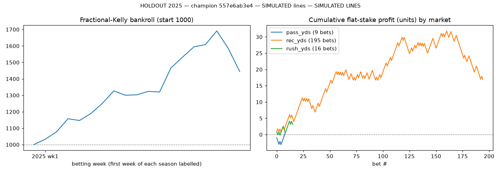
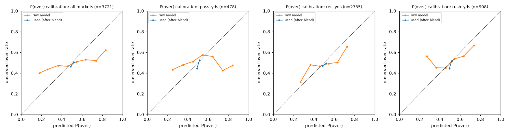
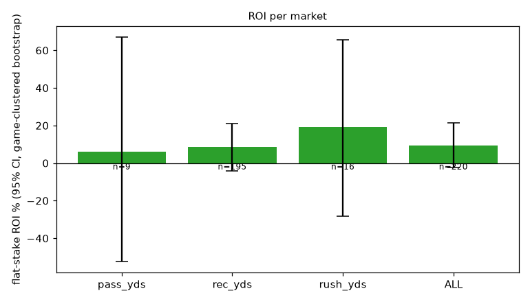

# HOLDOUT 2025 — champion 557e6ab3e4 — SIMULATED lines

> **SIMULATED LINES.** Every betting number below is measured against *simulated* sharp-market lines (see README, 'Simulated lines'). They are a research stress-test, **not evidence of real-world profitability**.

* seasons: [2025]  |  line source: `simulated_sharp (history 2019-2024 sim)`

* betting params: probabilities=stacker, edge_threshold=0.04, kelly_fraction=0.25, caps: bet 0.02, game 0.04 (max 3 bets), team-game 0.03, 1 bet/player-game, week 0.2
* bankroll: 1000 → **1444**, max drawdown **-14.6%**, turnover 3789
* model: `{"feature_set": "full", "use_snaps": true, "use_market_proj": true, "dist": "empirical", "retrain_every_weeks": 4, "n_folds": 3, "lgbm": {"n_estimators": 400, "learning_rate": 0.03, "num_leaves": 7, "min_child_samples": 50, "colsample_bytree": 0.8, "reg_lambda": 1.0}}`

## Per market

| market | lines | bets (O/U) | hit rate | flat ROI [95% CI, game-clustered] | Kelly ROI | Brier used / mkt | log loss raw model / used / mkt | MAE model | MAE naive EWMA | MAE public proj | MAE line | CRPS |
|---|---|---|---|---|---|---|---|---|---|---|---|---|
| pass_yds | 478 | 9 (7/2) | 55.6% | 6.1% [-52.3%, 67.0%] | 10.6% | 0.2500 / 0.2500 | 0.7716 / 0.6932 / 0.6931 | 60.25 | 64.62 | 64.69 | 52.63 | 43.12 |
| rec_yds | 2335 | 195 (153/42) | 56.9% | 8.7% [-4.1%, 21.2%] | 11.0% | 0.2497 / 0.2500 | 0.7002 / 0.6926 / 0.6931 | 22.93 | 24.31 | 24.09 | 21.81 | 15.90 |
| rush_yds | 908 | 16 (16/0) | 62.5% | 19.3% [-28.4%, 65.5%] | 21.1% | 0.2491 / 0.2500 | 0.6920 / 0.6914 / 0.6931 | 24.76 | 25.84 | 25.68 | 23.78 | 17.51 |
| ALL | 3721 | 220 (176/44) | 57.3% | 9.3% [-2.3%, 21.6%] | 11.7% | 0.2496 / 0.2500 | 0.7073 / 0.6924 / 0.6931 | 28.17 | 29.86 | 29.70 | 26.25 | 19.79 |

Brier/log loss are for P(over) on **every** priced line (not just bets): *raw model* = the distributional model alone, *used* = after the rolling stacker (market probability until a market has enough earlier lines), *mkt* = no-vig implied probability. A model has information beyond the line only if its log loss is *below* the market's. ROI CIs are game-clustered bootstrap intervals. MAE columns compare the model mean to a naive EWMA, the public projection and the line.

## Per season

| season | lines | bets | hit rate | flat ROI | log loss model / mkt | MAE model / naive |
|---|---|---|---|---|---|---|
| 2025 | 3721 | 220 | 57.3% | 9.3% | 0.6924 / 0.6931 | 28.17 / 29.86 |

## Reliability (all markets, P(over) used for betting)

| bin mean pred | observed over rate | n |
|---|---|---|
| 0.486 | 0.462 | 1104 |
| 0.519 | 0.504 | 2614 |
| 0.606 | 0.667 | 3 |

## Charts

## Fixed policy (not tuned; = the pre-declared holdout policy): probabilities=stacker, edge_threshold=0.04, kelly_fraction=0.25, exposure caps as config

Bankroll 1000 → 1444, max drawdown -14.6%.

| market | lines | bets (O/U) | hit rate | flat ROI [95% CI, game-clustered] | Kelly ROI | Brier used / mkt | log loss raw model / used / mkt | MAE model | MAE naive EWMA | MAE public proj | MAE line | CRPS |
|---|---|---|---|---|---|---|---|---|---|---|---|---|
| pass_yds | 478 | 9 (7/2) | 55.6% | 6.1% [-52.3%, 67.0%] | 10.6% | 0.2500 / 0.2500 | 0.7716 / 0.6932 / 0.6931 | 60.25 | 64.62 | 64.69 | 52.63 | 43.12 |
| rec_yds | 2335 | 195 (153/42) | 56.9% | 8.7% [-4.1%, 21.2%] | 11.0% | 0.2497 / 0.2500 | 0.7002 / 0.6926 / 0.6931 | 22.93 | 24.31 | 24.09 | 21.81 | 15.90 |
| rush_yds | 908 | 16 (16/0) | 62.5% | 19.3% [-28.4%, 65.5%] | 21.1% | 0.2491 / 0.2500 | 0.6920 / 0.6914 / 0.6931 | 24.76 | 25.84 | 25.68 | 23.78 | 17.51 |
| ALL | 3721 | 220 (176/44) | 57.3% | 9.3% [-2.3%, 21.6%] | 11.7% | 0.2496 / 0.2500 | 0.7073 / 0.6924 / 0.6931 | 28.17 | 29.86 | 29.70 | 26.25 | 19.79 |

## Stacker coefficients (fit on strictly earlier weeks; c = model weight)

| market   |     n |     a |   b |      c |   week |
|:---------|------:|------:|----:|-------:|-------:|
| pass_yds |  2751 | 0.046 |   1 | -0.09  |      1 |
| pass_yds |  2770 | 0.043 |   1 | -0.085 |      2 |
| pass_yds |  2799 | 0.043 |   1 | -0.085 |      3 |
| pass_yds |  2827 | 0.036 |   1 | -0.077 |      4 |
| pass_yds |  2857 | 0.037 |   1 | -0.075 |      5 |
| pass_yds |  2882 | 0.043 |   1 | -0.075 |      6 |
| pass_yds |  2910 | 0.048 |   1 | -0.077 |      7 |
| pass_yds |  2940 | 0.05  |   1 | -0.076 |      8 |
| pass_yds |  2962 | 0.052 |   1 | -0.073 |      9 |
| pass_yds |  2986 | 0.055 |   1 | -0.071 |     10 |
| pass_yds |  3012 | 0.053 |   1 | -0.071 |     11 |
| pass_yds |  3040 | 0.049 |   1 | -0.078 |     12 |
| pass_yds |  3065 | 0.049 |   1 | -0.079 |     13 |
| pass_yds |  3093 | 0.048 |   1 | -0.077 |     14 |
| pass_yds |  3120 | 0.043 |   1 | -0.078 |     15 |
| pass_yds |  3149 | 0.049 |   1 | -0.083 |     16 |
| pass_yds |  3178 | 0.047 |   1 | -0.086 |     17 |
| pass_yds |  3204 | 0.048 |   1 | -0.086 |     18 |
| rec_yds  | 14209 | 0.034 |   1 |  0.245 |      1 |
| rec_yds  | 14351 | 0.033 |   1 |  0.245 |      2 |
| rec_yds  | 14489 | 0.032 |   1 |  0.243 |      3 |
| rec_yds  | 14635 | 0.03  |   1 |  0.248 |      4 |
| rec_yds  | 14774 | 0.027 |   1 |  0.252 |      5 |
| rec_yds  | 14896 | 0.028 |   1 |  0.258 |      6 |
| rec_yds  | 15021 | 0.027 |   1 |  0.26  |      7 |
| rec_yds  | 15149 | 0.026 |   1 |  0.261 |      8 |
| rec_yds  | 15266 | 0.026 |   1 |  0.26  |      9 |
| rec_yds  | 15390 | 0.027 |   1 |  0.264 |     10 |
| rec_yds  | 15504 | 0.027 |   1 |  0.265 |     11 |
| rec_yds  | 15632 | 0.025 |   1 |  0.264 |     12 |
| rec_yds  | 15753 | 0.025 |   1 |  0.265 |     13 |
| rec_yds  | 15899 | 0.023 |   1 |  0.264 |     14 |
| rec_yds  | 16025 | 0.021 |   1 |  0.261 |     15 |
| rec_yds  | 16160 | 0.021 |   1 |  0.257 |     16 |
| rec_yds  | 16297 | 0.022 |   1 |  0.259 |     17 |
| rec_yds  | 16429 | 0.02  |   1 |  0.255 |     18 |
| rush_yds |  5399 | 0.054 |   1 |  0.097 |      1 |
| rush_yds |  5453 | 0.047 |   1 |  0.112 |      2 |
| rush_yds |  5504 | 0.047 |   1 |  0.109 |      3 |
| rush_yds |  5553 | 0.046 |   1 |  0.114 |      4 |
| rush_yds |  5606 | 0.048 |   1 |  0.119 |      5 |
| rush_yds |  5659 | 0.044 |   1 |  0.125 |      6 |
| rush_yds |  5710 | 0.042 |   1 |  0.123 |      7 |
| rush_yds |  5759 | 0.039 |   1 |  0.126 |      8 |
| rush_yds |  5800 | 0.039 |   1 |  0.126 |      9 |
| rush_yds |  5844 | 0.039 |   1 |  0.125 |     10 |
| rush_yds |  5893 | 0.041 |   1 |  0.126 |     11 |
| rush_yds |  5941 | 0.042 |   1 |  0.13  |     12 |
| rush_yds |  5985 | 0.043 |   1 |  0.135 |     13 |
| rush_yds |  6041 | 0.045 |   1 |  0.14  |     14 |
| rush_yds |  6089 | 0.047 |   1 |  0.142 |     15 |
| rush_yds |  6144 | 0.043 |   1 |  0.134 |     16 |
| rush_yds |  6200 | 0.049 |   1 |  0.137 |     17 |
| rush_yds |  6257 | 0.048 |   1 |  0.14  |     18 |