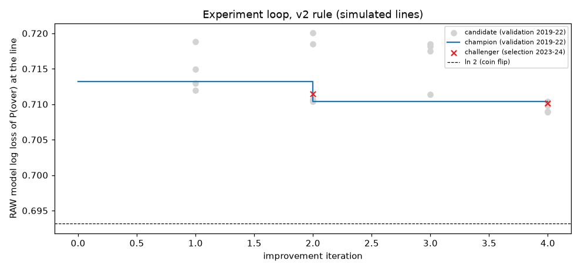

# NFL player-prop research pipeline — summary report (v2, after Tester1 review)

> **Read this first.** No real historical prop odds exist in this pipeline for 2015-2024. Every betting metric for
> 2019-2024 is measured against **SIMULATED** lines and **cannot show real-world profitability**. The only test
> against real prices is the frozen 2025 holdout against **ESPN BET lines of uncertain timing** (one book, weeks
> 1-13). ESPN's timestamps are last-update times, 99.3% of them after kickoff, so these are not clean opening lines.

## Data actually used
* nflverse weekly player stats, snap counts and schedules (from schedules only rest days, roof, home/away, division,
  and PRIOR games' scores and starting QBs are used; no spread/total/weather/actual-starter features since v2), seasons **2015–2025**,
  75,437 offensive player-game rows. Feature version `v2-asof`.
* Walk-forward periods: validation [2019, 2020, 2021, 2022], selection [2023, 2024], frozen holdout 2025.
* Simulated-line calibration (pre-validation seasons only): `{"pass_yds": {"beta": 0.4061, "info_noise_sd": 59.584, "noise_mult": 0.8712, "c": 0.9672, "calib_ratio": 0.82, "calib_over_rate": 0.477, "calib_seasons": [2017, 2018]}, "rush_yds": {"beta": 0.0822, "info_noise_sd": 73.424, "noise_mult": 3.7315, "c": 0.8139, "calib_ratio": 0.93, "calib_over_rate": 0.4943, "calib_seasons": [2017, 2018]}, "rec_yds": {"beta": 0.0884, "info_noise_sd": 60.522, "noise_mult": 3.4344, "c": 0.7731, "calib_ratio": 0.93, "calib_over_rate": 0.4999, "calib_seasons": [2017, 2018]}}`
  (c = public-projection median multiplier, beta = efficient weight on the noisy inside-info signal,
  info_noise_sd = signal noise solved so MAE(line)/MAE(public projection) matches the ESPN ratios).

## Pre-declared 2025 holdout policy
`configs/holdout_policy.yaml`, sha1 **`c6e4aba2a15a01dbeda7bca75c49c97184932226`**, first published in this report at **2026-10-04T13:42:47-07:00**
(before the holdout was scored). `python -m nflprops.holdout` refuses to run unless this sha1 is in this file and
refuses to run twice.

```yaml
# PRE-DECLARED 2025 HOLDOUT POLICY (v2). Written before the v2 improvement loop finished and before any v2 holdout
# scoring. `python -m nflprops.holdout` refuses to run unless the sha1 of this file is printed in reports/REPORT.md,
# and refuses to run a second time (experiments/holdout_frozen.json) without --force.
# Nothing in here may be changed after the holdout has been scored.
version: 2
declared_by: "v2 pass after Tester1 review"
holdout_season: 2025
model: champion                 # whatever experiments/champion.json holds after the v2 improvement loop
primary:
  line_source: data/lines/espn_bet_2025_open_uncertain_timing.csv
  label: "ESPN BET lines of uncertain timing (2025 REG weeks 1-13; ESPN timestamps are last-update times, 99.3% after kickoff)"
  probabilities:
    method: stacker             # per-market logistic stacker  logit p = a + b*logit(p_mkt) + c*logit(p_model)
    lambda: 50                  # ridge prior toward (a,b,c) = (0,1,0) = "trust the market"
    min_n: 300                  # market probability (=> no bet) until a market has 300 earlier priced lines
    history: "strictly earlier 2025 weeks of the SAME real line source only (no earlier real lines exist; simulated lines are never mixed in)"
  bet_rule:
    edge_threshold: 0.04        # stacked p minus no-vig market p, on the chosen side
    require_positive_ev: true   # at the actual quoted price
    one_side_per_player_market: true
  staking:
    kelly_fraction: 0.25        # on the stacked probability
    max_bet_frac: 0.02
    max_game_frac: 0.04
    max_bets_per_game: 3
    max_team_frac: 0.03
    max_bets_per_player: 1      # per player-game (highest-edge market)
    max_week_exposure: 0.20
    start_bankroll: 1000
  markets: [pass_yds, rush_yds, rec_yds]
  universe: "model universe (min projection 20 yds; QBs = projected starter from prior weeks) intersected with ESPN lines"
  report:
    - "flat-stake ROI, hit rate, number of bets, by market and overall, with 95% GAME-clustered bootstrap CI (4000 resamples, seed 0)"
    - "Kelly bankroll path and max drawdown"
    - "log loss of P(over) on every priced line: raw model, stacked, no-vig market; paired game-clustered bootstrap of (market - raw) and (market - stacked)"
    - "stacker coefficients by week and market"
secondary:
  - "same champion on SIMULATED 2025 lines, stacker history = simulated 2019-2024 (labelled SIMULATED)"
  - "simulated vs real line realism diagnostic on overlapping player-games"
interpretation: "Single, small, one-book sample of uncertain timing. A CI that includes 0 is a null result. No parameter is re-tuned on it."
```

## Leakage check — current features: PASS; legacy v1 features: FAIL (as it should: test catches the v1 look-ahead)
The check rebuilds features after scrambling every post-cutoff row: player stats, snaps, **and** game-level schedule
fields (spread, total, moneylines, wind, temperature, scores, roof open/closed and the starting-QB ids). Pre-cutoff
feature values must be unchanged.

Current (`reports/leakage_check.txt`):
```
== current features ==
[PASS] cutoff 2019-11-10: 29,840 rows checked (269 on the cutoff day itself), 0 feature values changed; post-cutoff feature values changed by scramble: 2,969,371
[PASS] cutoff 2022-09-11: 47,150 rows checked (349 on the cutoff day itself), 0 feature values changed; post-cutoff feature values changed by scramble: 1,830,653
[PASS] cutoff 2024-12-22: 67,057 rows checked (295 on the cutoff day itself), 0 feature values changed; post-cutoff feature values changed by scramble: 515,396
[PASS] max |corr(feature, passing_yards)| = 0.919 (naive_pass_yds)
[PASS] max |corr(feature, rushing_yards)| = 0.763 (mkt_proj_rush_yds)
[PASS] max |corr(feature, receiving_yards)| = 0.661 (p_receiving_yards_ewm6)
OVERALL: PASS
```
Legacy v1 features (`reports/leakage_check_legacy_v1.txt`):
```
== LEGACY v1 features (expected to FAIL) ==
[FAIL] cutoff 2019-11-10: 29,840 rows checked (269 on the cutoff day itself), 1860 feature values changed; post-cutoff feature values changed by scramble: 2,886,649
   offending columns: {'implied_tt': 269, 'wind': 269, 'temp': 269, 'total_line': 269, 'team_spread': 269, 'mkt_proj_rec_yds': 233, 'mkt_proj_rush_yds': 171, 'dome': 49, 'mkt_proj_pass_yds': 40, 'is_starting_qb': 22}
[FAIL] cutoff 2022-09-11: 47,150 rows checked (349 on the cutoff day itself), 2427 feature values changed; post-cutoff feature values changed by scramble: 1,779,351
   offending columns: {'implied_tt': 349, 'wind': 349, 'temp': 349, 'total_line': 349, 'team_spread': 349, 'mkt_proj_rec_yds': 284, 'mkt_proj_rush_yds': 214, 'dome': 101, 'mkt_proj_pass_yds': 55, 'is_starting_qb': 28}
[FAIL] cutoff 2024-12-22: 67,057 rows checked (295 on the cutoff day itself), 2091 feature values changed; post-cutoff feature values changed by scramble: 500,706
   offending columns: {'implied_tt': 295, 'wind': 295, 'temp': 295, 'total_line': 295, 'team_spread': 295, 'mkt_proj_rec_yds': 271, 'mkt_proj_rush_yds': 201, 'dome': 76, 'mkt_proj_pass_yds': 47, 'is_starting_qb': 21}
[PASS] max |corr(feature, passing_yards)| = 0.926 (is_starting_qb)
[PASS] max |corr(feature, rushing_yards)| = 0.763 (mkt_proj_rush_yds)
[PASS] max |corr(feature, receiving_yards)| = 0.661 (p_receiving_yards_ewm6)
OVERALL: FAIL
```

## Improvement loop under the v2 promotion rule (experiments/runs.jsonl, experiments/champion.json)
Rule: rank candidates by validation **raw** model log loss (no market blend). The challenger must beat the champion
overall and in ≥ 3 of 4 validation seasons. On the selection seasons it
must then show a raw log-loss gain > z_adj × SE, where SE comes from a paired game-clustered bootstrap and
z_adj = Φ⁻¹(1 − 0.05/m), with m = the number of promotion tests so far (Bonferroni).
Candidates tried: **16**; promotion tests: **2**;
promotions: **1**.



|   iter | event                                                        | best candidate change                                    | val raw LL chal / champ   | val seasons better   | sel raw-LL gain   | SE (game-clustered)   | z_adj (Bonferroni m)   | required margin   | candidates tried so far   |
|-------:|:-------------------------------------------------------------|:---------------------------------------------------------|:--------------------------|:---------------------|:------------------|:----------------------|:-----------------------|:------------------|:--------------------------|
|      0 | initial champion                                             |                                                          | – / –                     | –                    | –                 | –                     | – (–)                  | –                 | –                         |
|      1 | no challenger (better in only 2/4 validation seasons)        | model.lgbm.min_child_samples=200                         | 0.71193 / 0.71322         | 2/4                  | –                 | –                     | – (–)                  | –                 | 4                         |
|      2 | PROMOTED                                                     | model.lgbm.num_leaves=7                                  | 0.71042 / 0.71322         | 4/4                  | 0.00149           | 0.00078               | 1.64 (1)               | 0.00128           | 8                         |
|      3 | no challenger (no candidate beat the champion on validation) | model.use_snaps=False                                    | 0.71136 / 0.71042         | 1/4                  | –                 | –                     | – (–)                  | –                 | 12                        |
|      4 | challenger rejected on selection seasons                     | model.lgbm.n_estimators=200, model.use_market_proj=False | 0.70892 / 0.71042         | 4/4                  | 0.00125           | 0.00070               | 1.96 (2)               | 0.00137           | 16                        |

All candidates (validation 2019-2022; betting params tuned on validation only; "best diag. blend" = the linear
market blend with the best validation log loss, a diagnostic only, 1.0 = model adds nothing):

| run_id   |   iteration | changes                                                       |   logloss_raw |   logloss_stacked |   logloss_market |   mae_model |   n_bets |     flat_roi |   edge_threshold |   kelly_fraction |   best diag. blend |
|:---------|------------:|:--------------------------------------------------------------|--------------:|------------------:|-----------------:|------------:|---------:|-------------:|-----------------:|-----------------:|-------------------:|
| r0003    |           1 | model.use_snaps=False                                         |      0.714933 |          0.692763 |         0.693147 |     29.2467 |        0 | nan          |             1    |             0.1  |               0.9  |
| r0004    |           1 | model.retrain_every_weeks=2, model.dist=normal                |      0.718803 |          0.692421 |         0.693147 |     29.084  |      290 |   0.0862069  |             0.04 |             0.25 |               0.9  |
| r0005    |           1 | model.lgbm.min_child_samples=200                              |      0.711933 |          0.692389 |         0.693147 |     28.9755 |      316 |   0.0572497  |             0.04 |             0.25 |               0.9  |
| r0006    |           1 | model.lgbm.min_child_samples=200, model.use_market_proj=False |      0.712916 |          0.692496 |         0.693147 |     29.0105 |      608 |   0.0361842  |             0.03 |             0.25 |               0.9  |
| r0007    |           2 | model.dist=normal                                             |      0.720049 |          0.692377 |         0.693147 |     29.161  |      895 |   0.0494667  |             0.03 |             0.25 |               0.9  |
| r0008    |           2 | model.lgbm.num_leaves=7                                       |      0.710415 |          0.692401 |         0.693147 |     28.9591 |      348 |   0.124608   |             0.04 |             0.25 |               0.9  |
| r0009    |           2 | model.lgbm.n_estimators=200                                   |      0.710663 |          0.692464 |         0.693147 |     28.9651 |      720 |   0.0659091  |             0.03 |             0.25 |               0.9  |
| r0010    |           2 | model.dist=normal, model.lgbm.min_child_samples=200           |      0.718467 |          0.692351 |         0.693147 |     28.9755 |      858 |   0.0435474  |             0.03 |             0.25 |               0.9  |
| r0012    |           3 | model.dist=normal                                             |      0.718136 |          0.69236  |         0.693147 |     28.9591 |      349 |   0.126856   |             0.04 |             0.25 |               0.9  |
| r0013    |           3 | model.dist=normal, model.lgbm.n_estimators=200                |      0.717536 |          0.692392 |         0.693147 |     28.8577 |      878 |   0.0436943  |             0.03 |             0.25 |               0.9  |
| r0014    |           3 | model.use_snaps=False                                         |      0.711358 |          0.692607 |         0.693147 |     29.0058 |      714 |   0.00802139 |             0.03 |             0.25 |               0.9  |
| r0015    |           3 | model.feature_set=player_proxy, model.dist=normal             |      0.718521 |          0.692323 |         0.693147 |     29.0209 |      971 |   0.0538339  |             0.03 |             0.25 |               0.9  |
| r0016    |           4 | model.feature_set=player_proxy                                |      0.710394 |          0.692366 |         0.693147 |     29.0209 |      919 |   0.0490652  |             0.03 |             0.25 |               0.9  |
| r0017    |           4 | model.lgbm.n_estimators=200, model.use_market_proj=False      |      0.708922 |          0.692388 |         0.693147 |     28.8631 |      859 |   0.0734469  |             0.03 |             0.25 |               0.75 |
| r0018    |           4 | model.retrain_every_weeks=2                                   |      0.709846 |          0.692366 |         0.693147 |     28.9233 |      359 |   0.0954672  |             0.04 |             0.25 |               0.9  |
| r0019    |           4 | model.lgbm.n_estimators=200                                   |      0.709003 |          0.692421 |         0.693147 |     28.8577 |      862 |   0.0519933  |             0.03 |             0.25 |               0.9  |

Champion `557e6ab3e4`: model `{"feature_set": "full", "use_snaps": true, "use_market_proj": true, "dist": "empirical", "retrain_every_weeks": 4, "n_folds": 3, "lgbm": {"n_estimators": 400, "learning_rate": 0.03, "num_leaves": 7, "min_child_samples": 50, "colsample_bytree": 0.8, "reg_lambda": 1.0}}`; validation-tuned betting `{"market_blend": 0.9, "val_logloss_best_blend": 0.692709004424788, "model_adds_nothing": false, "edge_threshold": 0.04, "kelly_fraction": 0.25, "val_log_growth": 0.5467593185974424, "no_bet": false, "stacker_model_weight_end": {"pass_yds": -0.05067308278193572, "rec_yds": 0.2508844096395508, "rush_yds": 0.03247428004616149}}`.

## Champion walk-forward 2019-2024 — SIMULATED lines
Full report: `reports/champion_walkforward_2019_2024_sim/report.md`. Tuned policy (validation-tuned edge/Kelly,
stacker probabilities, exposure caps): bankroll 1000 → 1997, max drawdown
-22.9%. Week-clustered 95% ROI CI: [0.6%, 13.5%].

| market | lines | bets (O/U) | hit rate | flat ROI [95% CI, game-clustered] | Kelly ROI | Brier used / mkt | log loss raw model / used / mkt | MAE model | MAE naive EWMA | MAE public proj | MAE line | CRPS |
|---|---|---|---|---|---|---|---|---|---|---|---|---|
| pass_yds | 2751 | 21 (20/1) | 47.6% | -9.1% [-45.5%, 27.3%] | -11.1% | 0.2500 / 0.2500 | 0.7762 / 0.6932 / 0.6931 | 61.52 | 64.66 | 64.63 | 53.19 | 44.42 |
| rec_yds | 14209 | 766 (565/201) | 56.3% | 7.4% [0.9%, 13.9%] | 6.5% | 0.2494 / 0.2500 | 0.6994 / 0.6919 / 0.6931 | 23.99 | 25.47 | 25.15 | 23.29 | 16.80 |
| rush_yds | 5399 | 17 (17/0) | 52.9% | 1.1% [-43.9%, 46.0%] | 6.8% | 0.2498 / 0.2500 | 0.7071 / 0.6928 / 0.6931 | 25.04 | 26.17 | 26.05 | 24.28 | 17.73 |
| ALL | 22359 | 804 (602/202) | 56.0% | 6.9% [0.3%, 13.2%] | 6.1% | 0.2496 / 0.2500 | 0.7107 / 0.6923 / 0.6931 | 28.86 | 30.46 | 30.22 | 27.21 | 20.42 |


## Fixed policy (not tuned; = the pre-declared holdout policy): probabilities=stacker, edge_threshold=0.04, kelly_fraction=0.25, exposure caps as config

Bankroll 1000 → 1997, max drawdown -22.9%.

| market | lines | bets (O/U) | hit rate | flat ROI [95% CI, game-clustered] | Kelly ROI | Brier used / mkt | log loss raw model / used / mkt | MAE model | MAE naive EWMA | MAE public proj | MAE line | CRPS |
|---|---|---|---|---|---|---|---|---|---|---|---|---|
| pass_yds | 2751 | 21 (20/1) | 47.6% | -9.1% [-45.5%, 27.3%] | -11.1% | 0.2500 / 0.2500 | 0.7762 / 0.6932 / 0.6931 | 61.52 | 64.66 | 64.63 | 53.19 | 44.42 |
| rec_yds | 14209 | 766 (565/201) | 56.3% | 7.4% [0.9%, 13.9%] | 6.5% | 0.2494 / 0.2500 | 0.6994 / 0.6919 / 0.6931 | 23.99 | 25.47 | 25.15 | 23.29 | 16.80 |
| rush_yds | 5399 | 17 (17/0) | 52.9% | 1.1% [-43.9%, 46.0%] | 6.8% | 0.2498 / 0.2500 | 0.7071 / 0.6928 / 0.6931 | 25.04 | 26.17 | 26.05 | 24.28 | 17.73 |
| ALL | 22359 | 804 (602/202) | 56.0% | 6.9% [0.3%, 13.2%] | 6.1% | 0.2496 / 0.2500 | 0.7107 / 0.6923 / 0.6931 | 28.86 | 30.46 | 30.22 | 27.21 | 20.42 |


Selection seasons only ([2023, 2024]); these were not used to tune this champion's betting params. Stacker history = validation seasons. Tuned policy:

| market | lines | bets (O/U) | hit rate | flat ROI [95% CI, game-clustered] | Kelly ROI | Brier used / mkt | log loss raw model / used / mkt | MAE model | MAE naive EWMA | MAE public proj | MAE line | CRPS |
|---|---|---|---|---|---|---|---|---|---|---|---|---|
| pass_yds | 928 | 10 (9/1) | 50.0% | -4.5% [-61.8%, 52.7%] | -6.3% | 0.2491 / 0.2500 | 0.7841 / 0.6914 / 0.6931 | 61.11 | 65.00 | 65.68 | 52.25 | 43.75 |
| rec_yds | 4595 | 429 (338/91) | 53.8% | 2.8% [-5.9%, 11.7%] | 2.7% | 0.2493 / 0.2500 | 0.7010 / 0.6917 / 0.6931 | 23.86 | 25.42 | 24.97 | 23.18 | 16.77 |
| rush_yds | 1816 | 17 (17/0) | 52.9% | 1.1% [-43.9%, 46.0%] | 6.8% | 0.2499 / 0.2500 | 0.7007 / 0.6930 / 0.6931 | 24.20 | 25.08 | 24.92 | 23.56 | 17.05 |
| ALL | 7339 | 456 (364/92) | 53.7% | 2.6% [-5.9%, 11.1%] | 2.6% | 0.2494 / 0.2500 | 0.7114 / 0.6920 / 0.6931 | 28.65 | 30.34 | 30.10 | 26.95 | 20.25 |


## Fixed policy (not tuned; = the pre-declared holdout policy): probabilities=stacker, edge_threshold=0.04, kelly_fraction=0.25, exposure caps as config

Bankroll 1000 → 1156, max drawdown -22.9%.

| market | lines | bets (O/U) | hit rate | flat ROI [95% CI, game-clustered] | Kelly ROI | Brier used / mkt | log loss raw model / used / mkt | MAE model | MAE naive EWMA | MAE public proj | MAE line | CRPS |
|---|---|---|---|---|---|---|---|---|---|---|---|---|
| pass_yds | 928 | 10 (9/1) | 50.0% | -4.5% [-61.8%, 52.7%] | -6.3% | 0.2491 / 0.2500 | 0.7841 / 0.6914 / 0.6931 | 61.11 | 65.00 | 65.68 | 52.25 | 43.75 |
| rec_yds | 4595 | 429 (338/91) | 53.8% | 2.8% [-5.9%, 11.7%] | 2.7% | 0.2493 / 0.2500 | 0.7010 / 0.6917 / 0.6931 | 23.86 | 25.42 | 24.97 | 23.18 | 16.77 |
| rush_yds | 1816 | 17 (17/0) | 52.9% | 1.1% [-43.9%, 46.0%] | 6.8% | 0.2499 / 0.2500 | 0.7007 / 0.6930 / 0.6931 | 24.20 | 25.08 | 24.92 | 23.56 | 17.05 |
| ALL | 7339 | 456 (364/92) | 53.7% | 2.6% [-5.9%, 11.1%] | 2.6% | 0.2494 / 0.2500 | 0.7114 / 0.6920 / 0.6931 | 28.65 | 30.34 | 30.10 | 26.95 | 20.25 |


## Sensitivity: selection-period result vs simulated-market sharpness (fixed policy, SIMULATED)
| simulated market                                   |   bets | hit rate   | flat ROI [95% CI]   | LL raw / stacked / mkt   |   final bankroll |
|:---------------------------------------------------|-------:|:-----------|:--------------------|:-------------------------|-----------------:|
| ref_share=0.0 (softer market)                      |   1358 | 58.3%      | 11.3% [6.3%, 16.3%] | 0.7085 / 0.6866 / 0.6931 |             2441 |
| ref_share=0.5 (DEFAULT)                            |    456 | 53.7%      | 2.6% [-5.9%, 11.1%] | 0.7114 / 0.6920 / 0.6931 |             1156 |
| ref_share=1.0 (market knows a strong public model) |    934 | 57.5%      | 9.8% [3.6%, 15.7%]  | 0.7248 / 0.6918 / 0.6931 |             2410 |

## Frozen holdout 2025
Scored at 2026-10-04T13:45:13-07:00 (policy sha1 `c6e4aba2a15a01dbeda7bca75c49c97184932226`, champion `557e6ab3e4`). Read from `experiments/holdout_frozen.json`; not re-scored by this script.

### PRIMARY: ESPN BET lines of uncertain timing (REAL prices, 2025 REG wk 1-13)

Bankroll 1000 → **981** (Kelly -18.1% ROI on turnover), max drawdown -2.3%. First week with stacker coefficients (bets possible) by market: {'rec_yds': 4, 'rush_yds': 8}. Report: `reports/holdout_2025_real_espn_uncertain_timing/report.md`

| market   |   lines |   bets |   games bet | hit rate   | flat ROI [95% CI, game-clustered]   | LL raw / stacked / mkt   | LL gain raw vs mkt [95% CI]   | LL gain stacked vs mkt [95% CI]   | MAE model / line   |
|:---------|--------:|-------:|------------:|:-----------|:------------------------------------|:-------------------------|:------------------------------|:----------------------------------|:-------------------|
| pass_yds |     317 |      0 |           0 | –          | – [–, –]                            | 0.7148 / 0.6895 / 0.6895 | -0.0252 [-0.0452, -0.0061]    | +0.0000 [+0.0000, +0.0000]        | 60.25 / 55.45      |
| rec_yds  |    1487 |      0 |           0 | –          | – [–, –]                            | 0.7033 / 0.6907 / 0.6915 | -0.0118 [-0.0218, -0.0022]    | +0.0007 [-0.0005, +0.0020]        | 22.93 / 22.39      |
| rush_yds |     559 |     18 |          17 | 50.0%      | -6.7% [-45.4%, 34.2%]               | 0.7219 / 0.6924 / 0.6913 | -0.0306 [-0.0541, -0.0075]    | -0.0011 [-0.0042, +0.0020]        | 24.76 / 24.08      |
| ALL      |    2363 |     18 |          17 | 50.0%      | -6.7% [-45.4%, 34.2%]               | 0.7093 / 0.6910 / 0.6912 | -0.0181 [-0.0269, -0.0091]    | +0.0002 [-0.0009, +0.0013]        | 28.17 / 27.23      |

Last stacker coefficients (c = model weight): {"rec_yds": {"t": 202513, "n": 1366, "a": -0.071, "b": 0.966, "c": 0.036}, "rush_yds": {"t": 202513, "n": 509, "a": -0.101, "b": 1.0, "c": 0.012}}

### Secondary: SIMULATED 2025 lines (not evidence of real profitability)

Bankroll 1000 → **1444** (Kelly 11.7% ROI on turnover), max drawdown -14.6%. First week with stacker coefficients (bets possible) by market: {'pass_yds': 1, 'rec_yds': 1, 'rush_yds': 1}. Report: `reports/holdout_2025_sim/report.md`

| market   |   lines |   bets |   games bet | hit rate   | flat ROI [95% CI, game-clustered]   | LL raw / stacked / mkt   | LL gain raw vs mkt [95% CI]   | LL gain stacked vs mkt [95% CI]   | MAE model / line   |
|:---------|--------:|-------:|------------:|:-----------|:------------------------------------|:-------------------------|:------------------------------|:----------------------------------|:-------------------|
| pass_yds |     478 |      9 |           8 | 55.6%      | 6.1% [-52.3%, 67.0%]                | 0.7716 / 0.6932 / 0.6931 | -0.0785 [-0.1160, -0.0417]    | -0.0001 [-0.0032, +0.0030]        | 60.25 / 52.63      |
| rec_yds  |    2335 |    195 |         141 | 56.9%      | 8.7% [-4.1%, 21.2%]                 | 0.7002 / 0.6926 / 0.6931 | -0.0070 [-0.0140, -0.0005]    | +0.0006 [-0.0013, +0.0024]        | 22.93 / 21.81      |
| rush_yds |     908 |     16 |          15 | 62.5%      | 19.3% [-28.4%, 65.5%]               | 0.6920 / 0.6914 / 0.6931 | +0.0012 [-0.0116, +0.0139]    | +0.0018 [-0.0004, +0.0041]        | 24.76 / 23.78      |
| ALL      |    3721 |    220 |         155 | 57.3%      | 9.3% [-2.3%, 21.6%]                 | 0.7073 / 0.6924 / 0.6931 | -0.0142 [-0.0216, -0.0070]    | +0.0008 [-0.0005, +0.0021]        | 28.17 / 26.25      |

Last stacker coefficients (c = model weight): {"pass_yds": {"t": 202518, "n": 3204, "a": 0.048, "b": 1.0, "c": -0.086}, "rec_yds": {"t": 202518, "n": 16429, "a": 0.02, "b": 1.0, "c": 0.255}, "rush_yds": {"t": 202518, "n": 6257, "a": 0.048, "b": 1.0, "c": 0.14}}

**Simulated vs real lines on the same 2025 player-games** (simulator realism):

|          |   n_overlap |   mae_sim_line |   mae_real_line |   mae_model_mean |   over_rate_sim |   over_rate_real |   mean_sim_minus_real |   corr_sim_real |
|:---------|------------:|---------------:|----------------:|-----------------:|----------------:|-----------------:|----------------------:|----------------:|
| pass_yds |         317 |         52.229 |          55.45  |           57.744 |           0.524 |            0.492 |                -4.634 |           0.476 |
| rec_yds  |        1487 |         22.475 |          22.392 |           23.409 |           0.496 |            0.474 |                -2.719 |           0.872 |
| rush_yds |         559 |         24.976 |          24.083 |           25.722 |           0.513 |            0.456 |                -4.642 |           0.845 |

